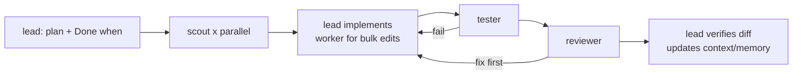

# How to use the AI setup

Shared Claude Code setup for `projects`. Rules, agents and skills live in `.claude/`; maintenance notes in [_ai/README.md](_ai/README.md); each project keeps its facts in `<project>/docs/ai/` and its Git checkout in `<project>/code/`.

## Start

1. Open Claude Code in `C:\Users\radug\Desktop\projects` (not in a project or `code/` folder), so `.claude/` skills, agents and settings load.
2. Name the project or paths in the request (`<project>/...`). Change `.claude/` or `_ai/` only when you mean to change the setup.
3. Say goal, scope, expected result and constraints. No credentials or customer rows: use placeholders.

## Pick the way to work

| Need | Use | Output |
|---|---|---|
| Question | default chat | chat |
| Small change in a few files, renames | default chat (runs tests, updates `context.md`/`memory.md`) | changes |
| Plan or design, risky path (loads, migrations, auth, shared config/schema), wide work (5+ files, research) | `lead` (starts on its own, or `/lead`) | plan or changes + `context.md` |
| Explain, document, write up a decision | `/analyze <scope>` | `docs/ai/reports/…-analyze-…md` |
| Review a change | `/review [files]` | chat |
| Audit a project or folder | `/review audit` | `docs/ai/reports/…-review-…md` |
| Something is broken or data is wrong | `/bug <symptom>` | fix + row in `memory.md` Bugs |
| Tables, DDL, load pipelines, Synapse notebooks | `/data <task>` | changes, runbook/design record if new |
| Read or update a Confluence page (link required) | `/confluence <link> <change>` | page title + new version |
| Smaller/larger code-change style | `/ponytail lite\|full\|ultra\|off` | this chat only |
| Run tests | "run the tests" (agent `tester`) | `docs/ai/reports/…-tester-…md` |
| Design, architecture, hard debugging | `/model opus` first, then `lead` | plan, then changes |

Skills combine: `lead` can use `/data` rules for a pipeline, `/bug` uses `tester` to verify a fix, `/review` is what the `reviewer` agent checks against.

## Agents (Haiku, started by `lead` or the main session)

| Agent | Does | Never (by tools or rule) |
|---|---|---|
| `scout` | read-only search in files and the public web | edit, run commands |
| `worker` | exact mechanical edits from a full spec | logic, design, terminal |
| `tester` | runs the project's test/lint commands, saves a report | edit code, Git, installs |
| `reviewer` | read-only review against the plan's Done when | edit, run commands |

## Safety

Single source: [.claude/instructions/global.instructions.md](.claude/instructions/global.instructions.md). [.claude/settings.json](.claude/settings.json) runs everything without prompts (personal device) and blocks the hard stops it can match by command: production/staging/hostinger/monitoring compose files, release/rollback scripts, SSH/SCP, Hostinger MCP write tools, force-push, `down -v` and volume deletion, reading `.env` files. The other hard stops (production databases, history rewrites, other secrets) are enforced by the global rules only. Production work happens only when you name the action in the chat.

## Where results go

| Result | Location |
|---|---|
| Stable facts, commands, guardrails, review focus | `<project>/docs/ai/project.md` |
| Current state and open work | `<project>/docs/ai/context.md` |
| Decisions, lessons, bugs | `<project>/docs/ai/memory.md` |
| Reports, runbooks, design records | `<project>/docs/ai/reports/` |
| Tests | `<project>/code/tests/` (or the project's test folder) |
| Your preferences across sessions | Claude Code auto-memory (not project facts) |
| Changes to this setup | chat; then this file and `_ai/README.md` |

## Add a project

1. Copy `_ai/templates/project/` to `projects/<Name>/` and replace `{{PROJECT}}` and `{{DATE}}`.
2. Clone the repo into `projects/<Name>/code`.
3. Fill `docs/ai/project.md` (at least At a glance, Guardrails, Commands). If the repo has its own `CLAUDE.md`/`AGENTS.md`, link it from `<Name>/CLAUDE.md`; the stricter rule wins.

## Change the setup

1. Ask for it explicitly ("change the AI setup: …").
2. Edit only in `.claude/` (rules, agents, skills) and `_ai/`; record external sources in `_ai/SOURCES.md`.
3. Run `node _ai/scripts/build-work.mjs` so the work setup (and the Obsidian copy) gets the same skill changes; details in [_ai/README.md](_ai/README.md). At work, apply it with [work/apply-from-vault.ps1](work/apply-from-vault.ps1) (see [work/HOW-TO-USE.md](work/HOW-TO-USE.md), "Update from the personal setup").
4. Start a new Claude Code session in `projects`, then commit and push (`GociuRadu/AI-Setup`).

## Troubleshooting

| Symptom | Try |
|---|---|
| Skill or agent missing | Claude Code started outside `projects`; restart it there and start a new session |
| Wrong project's rules used | Name the project/path in the request |
| A command was not run | A hard stop (deny list in settings.json); remove the line there if you really want it |
| Prompts still appear | In VS Code pick "Bypass permissions" in the mode selector once, or start a new session |
| Confluence unavailable | Check the Atlassian connector in Claude settings |
| Hostinger MCP times out | The server failed to connect; retry with `/mcp` |
