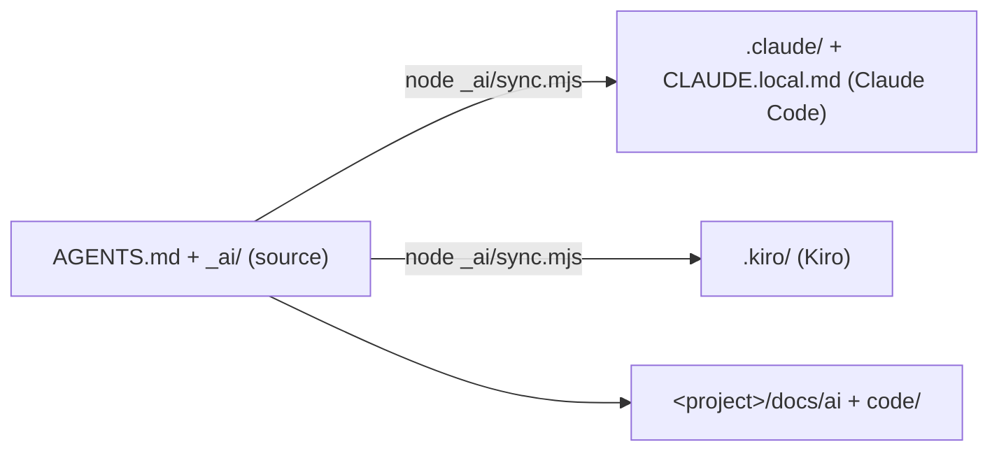

# AI setup

One AI setup for a workspace with several projects, generated for both Claude Code and Kiro from one source in `_ai/`.



## Install on a device

Requires Git and Node.js 18+.

```powershell
git clone <this repo> work; cd work
node _ai/sync.mjs home      # or work; writes .claude/, .kiro/, CLAUDE.local.md; ends with "synced"
node --test "_ai/**/*.test.mjs"
```

Open the `work` folder (not a project folder). Profile: `home` = no approval prompts, `work` = prompts for all but reads; later runs remember it. Kiro: Autopilot on home, Supervised on work.

## Layout

| Path | Purpose |
|---|---|
| [AGENTS.md](AGENTS.md) | Core workspace rules (language, autonomy, models, code, database and secret limits). |
| `_ai/agents/` | `orchestrator` (Opus) plus helpers `scout`, `tester` (Haiku), `worker`, `reviewer` and `challenger` (Sonnet). `_core.md` is prepended to helpers; in Claude Code they start without `AGENTS.md` (`omitClaudeMd`). |
| `_ai/skills/` | `plan`, `delegate`, `review` (modes review, bug, analyze), `data`, `handoff`, `confluence-project`. |
| `_ai/rules/` | File-scoped rules (`applyTo`): [python.md](_ai/rules/python.md), [sql.md](_ai/rules/sql.md), [report.md](_ai/rules/report.md). |
| `_ai/templates/` | `report.md` (report skeleton); project skeletons: `common` (shared `docs/ai`) plus `app` or `data-eng`. |
| [_ai/report.mjs](_ai/report.mjs) | Builds a report: Markdown in, one HTML file out, with diagrams and `scan:` warnings. Tests: `report.test.mjs`. |
| [_ai/hooks/guard.mjs](_ai/hooks/guard.mjs) | PreToolUse hook for Claude Code and Kiro; fails closed on hard limits. Tests: `guard.test.mjs`. |
| [_ai/sync.mjs](_ai/sync.mjs) | Generates `.claude/`, `.kiro/`, hooks and the local profile files (`--check` verifies sync, links and every `_ai/` path named in a source). Tests: `sync.test.mjs`. |
| `_ai/tools/`, `_ai/profiles/` | Per-tool name maps (Claude Code, Kiro) and device profiles (`home`, `work`). |
| [_ai/new-project.mjs](_ai/new-project.mjs) | `node _ai/new-project.mjs <Name> --template app\|data-eng` |
| `.claude/`, `.kiro/`, `CLAUDE.local.md` | Generated, gitignored. Never edit directly. |

## Daily use

| Need | Use |
|---|---|
| Question, small change | normal chat (Sonnet) |
| Design, multi-step work on Opus with helpers | `orchestrator` agent (Claude Code: `claude --agent orchestrator`) ([delegate skill](_ai/skills/delegate/SKILL.md)) |
| Delegate one task from a normal chat | `/delegate <task>` |
| Large task, design, options (with a `challenger` second opinion) | `/plan <goal>` |
| Review a change, audit, something is wrong, explain, list shortcuts | `/review [review \| bug \| analyze \| debt] <scope>` |
| Tables, loads, pipelines, notebooks | `/data <task>` |
| Project Confluence page | `/confluence-project <link> <change>` |
| Continue in a new chat | `/handoff` |

## Change the setup

1. Edit [AGENTS.md](AGENTS.md) or `_ai/` (never `.claude/` or `.kiro/`).
2. Run `node _ai/sync.mjs`, `node _ai/sync.mjs --check`, and `node --test "_ai/**/*.test.mjs"`.
3. Start a new chat, then commit.

New skill: `_ai/skills/<name>/SKILL.md` (`name` = folder name, `description`); link shared files by workspace path (`_ai/...`). New PRODUCTION host: add it to the hard stops in [_ai/hooks/guard.mjs](_ai/hooks/guard.mjs).

## Sources

The Code rules in `AGENTS.md`, the `reviewer` checklist and the `debt` mode of `review` adapt [Ponytail](https://github.com/DietrichGebert/ponytail) 5.3.3 (`96608e0`, MIT, Copyright (c) 2026 DietrichGebert). Not taken: levels, hooks, the band, `gain`, `help`. Re-sync: diff upstream `skills/ponytail/SKILL.md` against the Code section.
