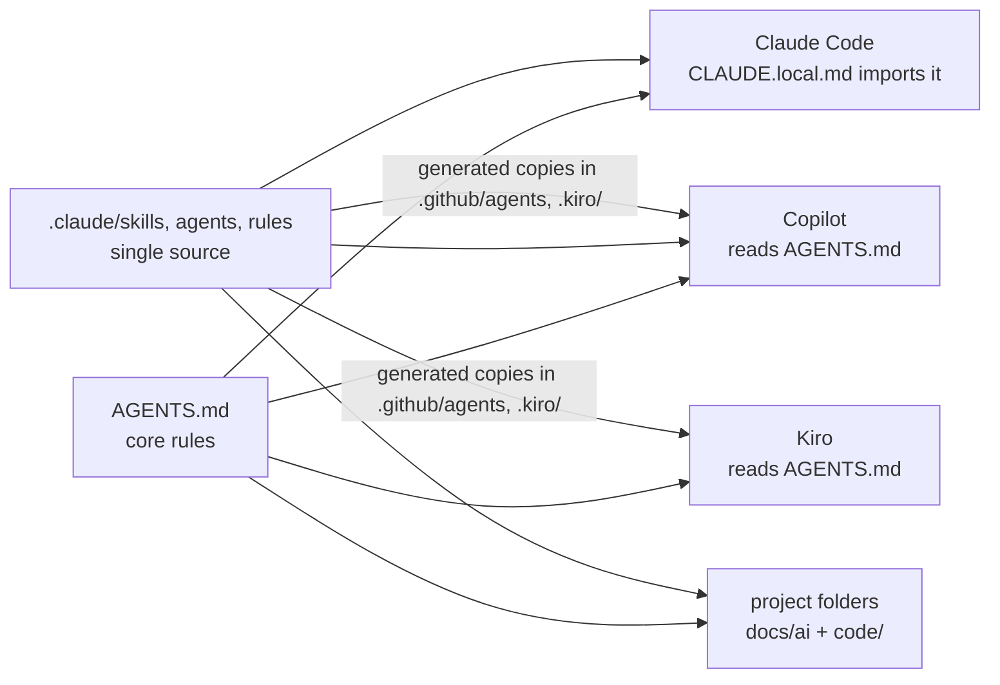

# AI Setup

One AI setup for a workspace with many projects, software engineering (`app`) and data engineering (`data-eng`) side by side. It behaves the same in Claude Code, GitHub Copilot (VS Code), Kiro and Codex. This repository is the workspace root: clone it, pick the device profile, open the folder.



## Install on a device

Requires Git and Node.js 18 or newer (the guard hook and the scripts run on Node).

```powershell
git clone https://github.com/GociuRadu/AI-Setup work
cd work
node _ai/setup.mjs home    # or: work
node _ai/check.mjs         # ends with "setup ok"
```

`setup.mjs` writes the profile files and lists every MCP server configured for Claude Code, Kiro and VS Code with how to turn it off; it changes none of them. Then open the `work` folder (the workspace root, not a project or `code/` folder).

| Profile | Behavior |
|---|---|
| `home` | Full autonomy: commands, tests, Docker and Git (feature branches) without asking. Kiro: Autopilot. |
| `work` | Asks before anything that is not a file read; Git writes only on request, never push. Kiro: Supervised. Also the default when no profile is set. |

In both profiles the agent only reads databases, never opens `.env` files, and never runs production, force-push or volume-deleting commands.

## Add a project

```powershell
node _ai/new-project.mjs Billing --template app        # then: git clone <url> Billing/code
node _ai/new-project.mjs SalesLoad --template data-eng # then: git init SalesLoad/code
```

Fill `<project>/docs/ai/project.md` (at least At a glance, Guardrails, Commands). Project folders are not part of this repository; each keeps its own Git repository in `code/`. `data-eng` includes a local Docker test environment (`code/local/SETUP-WSL.md`, `code/local/README.md`).

## Daily use

Name the project or path, the goal, the scope and the expected result. No credentials or customer rows.

| Need | Use | Output |
|---|---|---|
| Question, small change | normal chat | answer or changes |
| Plan, design, risky path, research | just ask; the main agent starts helpers when its table says so | plan or changes |
| Explain, document, write up a decision | `/analyze <scope>` | `docs/ai/reports/…-analyze-….md` |
| Review a change / audit a project | `/review [files]` / `/review audit` | chat / `docs/ai/reports/…-review-….md` |
| Something is wrong | `/bug <symptom>` | report with cause and proposed fix |
| Tables, DDL, loads, pipelines, Spark notebooks | `/data <task>` | changes, runbook and design record when new |
| Project Confluence page (link required) | `/confluence-project <link> <change>` | page title and new version |
| Smaller or larger code changes | `/ponytail lite\|full\|ultra\|off` | this chat only |
| Run the tests | "run the tests" | counts in chat (`tester`) |

The main agent works on Sonnet and suggests Opus for design or hard debugging. When to start a helper is a table in `AGENTS.md`; the brief and checks are in `_ai/orchestration.md`.

| Agent | Model | Does |
|---|---|---|
| `scout` | Haiku 5.5 | search in files, logs and the public web; long findings go to a report file |
| `worker` | Haiku 5.5 | bulk edits from an exact spec that no single command can apply |
| `tester` | Haiku 5.5 | runs the project's tests and lint, reports counts |
| `reviewer` | Sonnet 5.5 | read-only review of risky or shared-logic changes |

Results: stable facts in `<project>/docs/ai/project.md`, state in `context.md`, decisions and bugs in `memory.md`, reports in `docs/ai/reports/`, code and tests in `code/`.

## Layout

| Path | Purpose |
|---|---|
| `AGENTS.md` | Core rules, read by every tool (Claude Code through the `@AGENTS.md` import in `CLAUDE.local.md`) |
| `.claude/skills/`, `.claude/agents/`, `.claude/rules/` | Skills, helpers, SQL and Python rules: the single source. Claude Code and Copilot read them; Copilot also gets `.github/agents/` and Kiro `.kiro/skills/`, `.kiro/agents/`, `.kiro/steering/` copies, all generated by `check.mjs` |
| `_ai/claude.md`, `.github/copilot-instructions.md`, `.kiro/steering/kiro.md` | Tool adapters: tool and model names only |
| `_ai/helper-core.md` | The safety rules copied into every helper (Copilot starts helpers without `AGENTS.md`) |
| `_ai/orchestration.md` | Helper briefs, parallel runs, checks |
| `_ai/hooks/guard.mjs` | Blocks writing SQL, hard stops and secret reads; fails closed. Wired in `.claude/settings.json` (with deny rules), `.github/hooks/guard.json`, `.kiro/hooks/guard.json` |
| `_ai/hooks/lang.mjs` | Adds "reply in English" to every prompt; wired in `.claude/settings.json`, `.github/hooks/lang.json`, `.kiro/hooks/lang.json` |
| `_ai/profiles/`, `_ai/setup.mjs` | `home` and `work` profiles; `setup.mjs` writes them into `CLAUDE.local.md`, `.github/instructions/profile.instructions.md`, `.kiro/steering/profile.md` and `.claude/settings.local.json` |
| `_ai/templates/`, `_ai/new-project.mjs` | Project skeletons `app` and `data-eng` |
| `_ai/check.mjs` | Self-check; `--fix` regenerates the copies |

## Tool notes

- Always open the workspace root: the hooks run from there, and a tool started in a subfolder may not load the rules.
- Claude Code: accept the trust dialog once interactively; until then it ignores the `allow` rules. Deny rules and the guard apply either way. There is no root `CLAUDE.md` on purpose: Copilot also reads `CLAUDE.md` and would load `AGENTS.md` a second time through its import.
- Copilot (VS Code, Copilot harness): reads `AGENTS.md`, `.claude/skills/`, `.claude/rules/` and the hooks in `.claude/settings.json` on its own. The guard runs from both hook files. Copilot has no repository-level deny rules; a second layer needs admin-managed settings or policy hooks. If `AGENTS.md` is not loaded, turn on `chat.useAgentsMdFile`.
- Kiro: loads `.kiro/hooks/` in the IDE (1.0+) and CLI V3; the helpers also carry the guard as inline hooks. Kiro CLI V3 rewrites `.kiro/agents/*.json` on first run; `check.mjs` accepts that.

## Change the setup

1. Edit the source: `AGENTS.md`, `.claude/skills/<name>/SKILL.md`, `.claude/agents/<name>.md`, `.claude/rules/<name>.md`, `_ai/helper-core.md`, `_ai/claude.md` or `_ai/profiles/`. Behavior is never per tool; an adapter only maps names.
2. Run `node _ai/check.mjs --fix`, then `node _ai/check.mjs`. It checks headers, links, JSON, word limits and the guard tests.
3. After a profile or `_ai/claude.md` change, run `node _ai/setup.mjs <profile>` again. Start a new chat, then commit.

A new skill: `.claude/skills/<name>/SKILL.md` with `name` and `description`, listed in the Skills section of `AGENTS.md`. Text copied from an external repo keeps its license line at the top.
