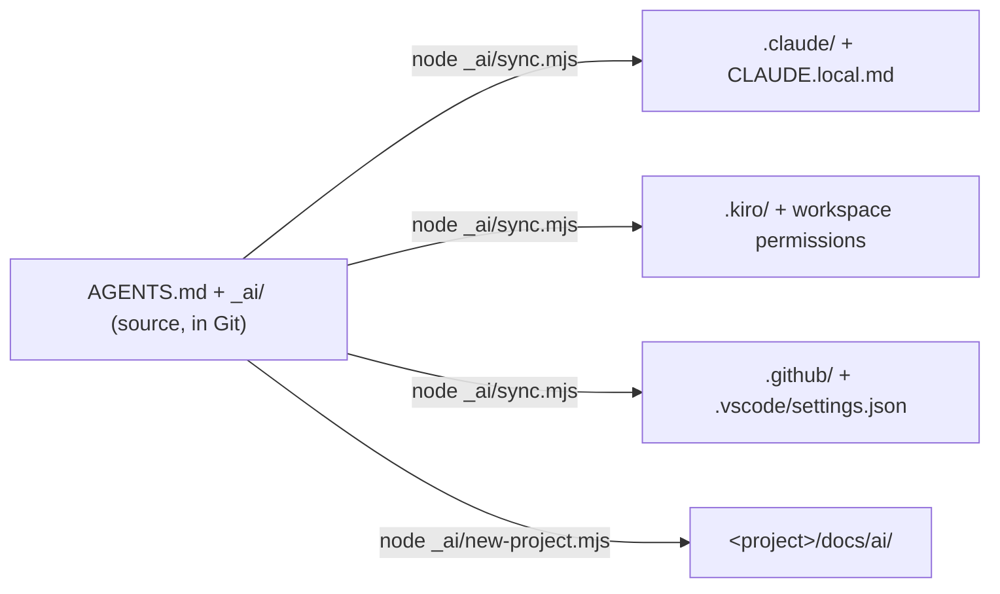

# AI Setup

Single source of truth for rules, skills, subagents and safety guards across **Claude Code**, **Kiro** and **GitHub Copilot**. Edit [AGENTS.md](AGENTS.md) and `_ai/`, then run `node _ai/sync.mjs` to generate only the files for the tools installed on this device.



## Quick start

Requires Git and Node.js 22+ (`node --test` glob support).

```powershell
git clone https://github.com/GociuRadu/AI-Setup work; cd work
node _ai/sync.mjs home --tools claude,kiro     # home PC
node _ai/sync.mjs work --tools copilot,kiro    # work laptop
node --test "_ai/**/*.test.mjs"
```

Open the root `work` folder (not a project subfolder) in VS Code, Claude Code or Kiro. Your choice is saved in `.ai-device.json` (gitignored), so future runs only need `node _ai/sync.mjs`. Removing a tool from `--tools` removes its generated files, including `.claude/settings.local.json`.

> **Do not enable `claude` and `copilot` together:** Copilot also reads `.claude/` and `CLAUDE.md`, which can double-fire hooks. `sync.mjs` warns on both write and `--check` if both are selected.

## Profiles and tools

| Profile | Autonomy | Enforced by |
|---|---|---|
| `home` | Runs end-to-end without asking, within [AGENTS.md](AGENTS.md) ([home.md](_ai/profiles/home.md)) | Claude `bypassPermissions`; Kiro Autopilot; guard hook still hard-blocks secrets, `personal/`, writing SQL and hard stops |
| `work` | Routine reads, searches, subagents, in-workspace edits and tests run automatically; asks on deletes, outside edits, Git writes, external CLI/network calls and mutating MCP tools ([work.md](_ai/profiles/work.md)) | Claude approvals + deny list + exec-form `onFailure: "block"` guard; Kiro Autopilot + workspace permissions + guard hook; Copilot `.vscode/settings.json` + Preview guard hook |

| Tool | Generated paths (replaced wholesale on sync) |
|---|---|
| `claude` | `.claude/`, `CLAUDE.local.md`, `.claude/settings.local.json` |
| `kiro` | `.kiro/` plus the generated rule block in `~/.kiro/workspace-roots/<hash>/permissions.yaml` |
| `copilot` | `.github/agents/`, `.github/skills/`, `.github/instructions/`, `.github/hooks/guard.json`, `.github/copilot-instructions.md` and managed keys in `.vscode/settings.json` |

Other files under `.github/` (such as workflows), custom keys in `.vscode/settings.json` and rules outside the generated markers in Kiro's `permissions.yaml` are preserved.

## Model configuration

Helpers declare capability tiers (`fast`, `balanced`, `deep`) instead of hardcoded vendor model names. Each tool has its own model profile in [_ai/models.json](_ai/models.json), so you can configure different models for Claude Code, Kiro and Copilot independently:

```json
{
  "copilot": {
    "tiers": {
      "fast": "Claude Haiku 5.5 (copilot)",
      "balanced": "Claude Sonnet 5.5 (copilot)",
      "deep": "Claude Opus 5.5 (copilot)"
    },
    "agents": {
      "tester": "Gemini 4 Neon (copilot)"
    }
  }
}
```

- **`tiers`:** maps `fast` (`scout`, `tester`), `balanced` (`worker`, `reviewer`, `challenger`) and `deep` to exact model IDs supported by that tool.
- **`agents`:** optional per-helper overrides for that tool (accepts another tier name like `"balanced"` or an exact model ID).
- **`claude.default` / `claude.subagentDefault`:** sets Claude Code's default chat model and `CLAUDE_CODE_SUBAGENT_MODEL` in `.claude/settings.json`.
- **Per-device overrides:** add an optional `"models"` object (same shape as `_ai/models.json`) inside local `.ai-device.json` when one machine has different available models; `node _ai/sync.mjs` preserves and applies it automatically.

## Daily workflow

Invoke a skill by `/<name>` or describe the task so its description routes it. Use Opus for design, data models, migrations, public interfaces or hard debugging; use Sonnet for routine work.

| Skill | Purpose |
|---|---|
| `/pplan <goal>` | Design and break down a large task (3+ files, schema, auth, shared interfaces); writes a plan file with a clear approval gate |
| `/delegate <task>` | Split work across helper subagents (`scout`, `tester`, `worker`, `reviewer`, `challenger`) with parallel reads and isolated writers |
| `/review [review \| bug \| analyze \| debt] <scope>` | Review code/PRs, diagnose a bug, explain a flow or list shortcuts; optional HTML report |
| `/data <task>` | Design or review data models, DDL, migrations, loads, pipelines and Spark notebooks |
| `/confluence-project <link> <change>` | Read, answer questions about or update a project Confluence page |
| `/learn <stage or topic>` | Research industry standards for a stage and write a study report with interview questions |
| `/retro [project or topic]` | Audit a session for recurring mistakes or non-obvious lessons and propose 1–2 line rule/memory updates for approval |
| `/handoff` | Print one paste-ready brief to continue cleanly in a new chat |
| `/clean [--days 7] [--reports]` | Dry-run inventory of stale logs, caches, transcripts and `.tmp` files; deletes only on confirmation |

### Helper subagents

Defined in `_ai/agents/` and launched through `/delegate` (never built-in generic subagents):

| Helper | Role | Write access |
|---|---|---|
| `scout` | Fast search across files, logs or the public web | Read-only |
| `tester` | Runs tests, linters and long-output commands | Read-only (executes checks) |
| `worker` | Implements a precise spec and named tests | Edits named files |
| `reviewer` | Fresh-eyes review for bugs, regressions, data loss, bloat | Read-only |
| `challenger` | Independent second opinion on expensive plan choices | Read-only |

## Projects

Each project lives in its own folder (`<Name>/code/` for its Git repo, `<Name>/docs/ai/` for AI state):

```powershell
node _ai/new-project.mjs <Name> --template app        # docs/ai/ only; clone the repo into <Name>/code/
node _ai/new-project.mjs <Name> --template data-eng   # docs/ai/ + local data-engineering skeleton in code/
```

Pass `--dest <dir>` to create outside the workspace; existing folders are never overwritten. Fill `docs/ai/project.md` once (stack, commands, DEV/PRODUCTION names). The agent maintains `docs/ai/context.md` (current state, under 40 lines), `docs/ai/memory.md` (decisions with review triggers and non-obvious bugs), `plans/` and `reports/`.

## Safety layers

Rules live in [AGENTS.md](AGENTS.md) and are enforced across four layers:

| Layer | Claude Code | Kiro | Copilot |
|---|---|---|---|
| Guard hook (`_ai/hooks/run-guard.mjs`) | Exec-form `node`, `onFailure: "block"`, `timeout: 10` | Catch-all `PreToolUse` in hook + every helper | Preview hook (`--allow`); timeout allows the call |
| Tool / path deny list | Yes (`**/.env*`, `personal/`, prod/destructive CLI, built-in agents, destructive MCP) | Filesystem deny (`**/.env*`, `personal/**`) + ask rules in `permissions.yaml` | Path auto-approve exclusions in `.vscode/settings.json` |
| Written rules | `AGENTS.md` + `CLAUDE.local.md` | `AGENTS.md` + `.kiro/steering/` | `AGENTS.md` + `.github/copilot-instructions.md` |
| English prompt hook (`_ai/hooks/lang.mjs`) | Exec-form `UserPromptSubmit` | `UserPromptSubmit` | `UserPromptSubmit --json` |

[_ai/hooks/guard.mjs](_ai/hooks/guard.mjs) inspects tool commands and paths before execution and fails closed if it cannot load. It hard-blocks writing SQL sent through CLI clients, PRODUCTION/staging hard stops, `.env`-style files and `personal/`. **Known limits:** code that opens a DB connection inside a script is not inspected (only the command/path is), an inline command mentioning a hard stop or `personal` is blocked (put it in a file instead), and Copilot hooks are still Preview.

## Repository layout

| Path | Purpose |
|---|---|
| [AGENTS.md](AGENTS.md) | Core rules for every chat; helpers receive only the sections they list |
| `_ai/agents/` | Helper specs (`_core.md` + 5 helpers); declare `fast`/`balanced`/`deep` tiers and optional Claude `isolation`/`memory` |
| [_ai/models.json](_ai/models.json) | Per-tool model profiles (`claude`, `kiro`, `copilot`): tier mappings, per-agent overrides and Claude defaults |
| `_ai/skills/` | The 9 skills above |
| `_ai/rules/` | Path-scoped rules loaded for Python, SQL and reports |
| `_ai/profiles/` | `home` and `work` autonomy profiles |
| `_ai/tools/` | Tool-specific notes (`claude-code.md`, `kiro.md`, `copilot.md`) |
| `_ai/hooks/` | Fail-closed guard (`run-guard.mjs`, `guard.mjs`) and English prompt hook (`lang.mjs`) |
| `_ai/templates/` | Project skeletons (`common`, `app`, `data-eng`) and the report template |
| [_ai/sync.mjs](_ai/sync.mjs) | Generates tool configs; `--check` verifies sync, links, paths and settings |
| [_ai/new-project.mjs](_ai/new-project.mjs) | Scaffolds a new project folder from a template |
| [_ai/report.mjs](_ai/report.mjs) | Compiles Markdown → self-contained HTML report; `--edit <file.html>` restores Markdown |
| [_ai/clean.mjs](_ai/clean.mjs) | Dry-run inventory of stale logs, caches and scratch files; `--apply` deletes |
| `docs/` | Plans and reports for this setup |
| `.claude/`, `.kiro/`, `.github/`, `CLAUDE.local.md`, `.ai-device.json` | Generated per device and gitignored |

## Maintaining the setup

1. Edit [AGENTS.md](AGENTS.md) or files under `_ai/` (never edit generated folders directly).
2. Sync and verify:
   ```powershell
   node _ai/sync.mjs
   node _ai/sync.mjs --check
   node --test "_ai/**/*.test.mjs"
   ```
3. Start a new chat so tools reload the generated files, then commit.

- **Add a skill:** create `_ai/skills/<name>/SKILL.md` with `name` matching the folder and a routing `description`; add it to the Daily workflow table and update the skill count in this README (checked by tests).
- **Add a helper:** create `_ai/agents/<name>.md` with `name`, `description`, `model` (`fast`, `balanced`, `deep`), `tools` (`read`, `search`, `web`, `edit`, `execute`) and `sections`; optional Claude-only `isolation` (`worktree`) and `memory` (`user`, `project`, `local`); register it in `/delegate`.
- **Change models:** edit [_ai/models.json](_ai/models.json) (shared across devices) or add a `"models"` block in `.ai-device.json` (this device only), then run `node _ai/sync.mjs`.
- **Rename an `AGENTS.md` section:** update every `sections:` list in `_ai/agents/` and `_ai/tools/` (sync fails on unknown names), keep helper-copied sections free of chat-only wording, and keep `Databases` (linked by `/data`).
- **Add a PRODUCTION host:** add it to [_ai/hooks/guard.mjs](_ai/hooks/guard.mjs) and [_ai/hooks/guard.test.mjs](_ai/hooks/guard.test.mjs).

## Credits

- Code rules in [AGENTS.md](AGENTS.md), the `reviewer` checklist and `/review debt` adapt [Ponytail](https://github.com/DietrichGebert/ponytail) 5.3.3 (`96608e0`, MIT, Copyright (c) 2026 DietrichGebert); levels, hooks, the band, `gain` and `help` were omitted.
- The decision **Review** column in `memory.md` is adapted from [chief-of-staff](https://github.com/alirezarezvani/claude-skills/tree/main/c-level-advisor/skills/chief-of-staff) (MIT); routing and board-meeting flows were omitted.
