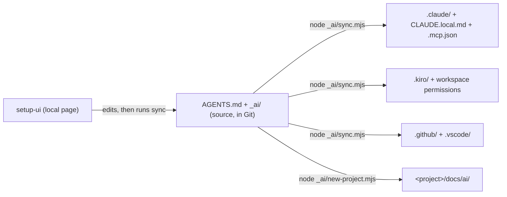

# AI Setup

One source of rules, skills, helper subagents, MCP servers and safety guards for **Claude Code**, **Kiro** and **GitHub Copilot**. You edit [AGENTS.md](AGENTS.md) and `_ai/`; `node _ai/sync.mjs` generates the files for the tools installed on this device.



## Contents

- [Quick start](#quick-start)
- [How it works](#how-it-works)
- [Configure](#configure): [models](#models), [per-tool switches](#per-tool-switches), [MCP servers](#mcp-servers), [setup page](#setup-page)
- [Daily use](#daily-use): [skills](#skills), [helpers](#helpers), [projects](#projects)
- [Safety](#safety)
- [Repository layout](#repository-layout)
- [Maintaining the setup](#maintaining-the-setup)
- [Credits](#credits)

## Quick start

Needs Git and Node.js 22+ (for `node --test` globs).

```powershell
git clone https://github.com/GociuRadu/AI-Setup work; cd work
node _ai/sync.mjs home --tools claude,kiro     # home PC
node _ai/sync.mjs work --tools copilot,kiro    # work laptop
node --test "_ai/**/*.test.mjs"
```

Open the root `work` folder, not a project subfolder, in VS Code, Claude Code or Kiro. The profile and tools are saved in `.ai-device.json` (gitignored), so later runs need only `node _ai/sync.mjs`. To change settings from a page instead of JSON, see [Setup page](#setup-page).

> **Do not turn on `claude` and `copilot` together.** Copilot also reads `.claude/` and `CLAUDE.md`, so hooks can fire twice. Sync and `--check` warn when both are on.

## How it works

**Source vs generated.** `AGENTS.md` and `_ai/` are versioned; everything a tool reads is generated from them and replaced whole on each sync. Never edit generated files.

| Tool | Generated paths |
|---|---|
| `claude` | `.claude/`, `CLAUDE.local.md`, `.mcp.json`, `.claude/settings.local.json` |
| `kiro` | `.kiro/` (with `.kiro/settings/mcp.json`) and the generated rule block in `~/.kiro/workspace-roots/<hash>/permissions.yaml` |
| `copilot` | `.github/agents/`, `.github/skills/`, `.github/instructions/`, `.github/hooks/guard.json`, `.github/copilot-instructions.md`, `.vscode/mcp.json` and managed keys in `.vscode/settings.json` |

Kept on sync: other files under `.github/` (such as workflows), your own keys in `.vscode/settings.json`, servers you added to the 3 MCP files, and rules outside the generated markers in Kiro's `permissions.yaml`. Removing a tool from `--tools` removes its generated files.

**Profiles** set how much runs without asking:

| Profile | Autonomy | Enforced by |
|---|---|---|
| `home` | Runs end to end without asking, within [AGENTS.md](AGENTS.md) ([home.md](_ai/profiles/home.md)) | Claude `bypassPermissions`; Kiro Autopilot; the guard hook still blocks secrets, `personal/`, writing SQL and hard stops |
| `work` | Reads, searches, subagents, workspace edits and tests run; asks on deletes, outside edits, Git writes, external CLI/network calls and mutating MCP tools ([work.md](_ai/profiles/work.md)) | Claude approvals + deny list + guard (`onFailure: "block"`); Kiro Autopilot + workspace permissions + guard; Copilot `.vscode/settings.json` + Preview guard hook |

## Configure

All settings live in 3 files: [_ai/models.json](_ai/models.json) and [_ai/mcp.json](_ai/mcp.json) (shared, in Git) and `.ai-device.json` (this device only). Run `node _ai/sync.mjs` after a change, or use the [setup page](#setup-page).

### Models

Helpers declare a tier (`fast`, `balanced`, `deep`), not a vendor model. Each tool maps tiers to its own model IDs:

```json
{
  "copilot": {
    "tiers": { "fast": "Claude Haiku 5.5 (copilot)", "balanced": "Claude Sonnet 5.5 (copilot)", "deep": "Claude Opus 5.5 (copilot)" },
    "agents": { "tester": "Gemini 4 Neon (copilot)" }
  }
}
```

- **`tiers`:** `fast` runs `scout` and `tester`; `balanced` runs `worker`, `reviewer` and `challenger`.
- **`agents`:** optional per-helper override, a tier name or an exact model ID.
- **`available`:** model IDs the setup page suggests for that tool.
- **`claude.default` / `claude.subagentDefault`:** Claude Code's chat model and `CLAUDE_CODE_SUBAGENT_MODEL`.
- **This device only:** a `"models"` block with the same shape in `.ai-device.json`; it wins over `_ai/models.json`.

### Per-tool switches

`perTool` in `.ai-device.json` turns hooks, skills and MCP servers off for one tool. A missing key means on; sync rejects an unknown tool, hook, skill or server name.

```json
{
  "profile": "home",
  "tools": ["claude", "kiro"],
  "perTool": {
    "kiro": { "hooks": { "lang": false }, "skillsOff": ["learn"] },
    "claude": { "mcpOff": ["atlassian"] }
  }
}
```

- **`hooks`:** `guard` and `lang` (`HOOKS` in [_ai/sync.mjs](_ai/sync.mjs)). With `guard` off, shell reads of `.env`/`personal/`, writing SQL and hard stops are no longer blocked for that tool; sync and `--check` print `guard: off for <tool>`.
- **`skillsOff`:** skill folders left out of that tool.
- **`mcpOff`:** MCP servers left out of that tool. Kiro gets them as `"disabled": true`, which also turns off a server with the same name in `~/.kiro/settings/mcp.json`.

### MCP servers

[_ai/mcp.json](_ai/mcp.json) lists the MCP servers once; sync writes each tool's own format: `.mcp.json` (Claude Code), `.kiro/settings/mcp.json` (Kiro), `.vscode/mcp.json` (Copilot).

```json
{
  "servers": {
    "atlassian": { "description": "Jira, Confluence and Compass", "type": "http", "url": "https://mcp.atlassian.com/v2/mcp" },
    "example-local": { "type": "stdio", "command": "npx", "args": ["-y", "<package>"], "env": { "API_TOKEN": "${EXAMPLE_TOKEN}" } }
  }
}
```

- **Keys:** `type` (`http` or `stdio`), `url` for http, `command` and optional `args` for stdio, optional `env`, `headers` and `description`. A name is lowercase letters, digits and dashes.
- **Merged, not replaced:** sync replaces or removes only the servers named in `_ai/mcp.json`; servers a tool added itself (Kiro, VS Code "MCP: Add Server", `claude mcp add`) stay. A server deleted from `_ai/mcp.json` stays in the tool files too: delete it there as well.
- **No secrets:** an `env` or `headers` value is `${NAME}` or `<Scheme> ${NAME}` (such as `Bearer ${TOKEN}`), and a `url` carries no user, password or literal query value; sync refuses anything else. `args` are not checked: pass a secret through `env`. Copilot gets variables as `${env:NAME}`. Remote servers such as Atlassian sign in with OAuth inside each tool.
- **Hard stop:** Claude Code denies `executeDestructive` on every server here, as AGENTS.md requires; in Kiro and Copilot the guard hook blocks it.
- **claude.ai connectors** (Atlassian, Gmail, ... added in your claude.ai account) are not in this file; they reach Claude Code through your account. Turn a server off for `claude` in `mcpOff` when a connector already covers it.
- **First use:** Claude Code asks once to approve the servers in `.mcp.json`.

### Setup page

A local page in [setup-ui/](setup-ui/) (React + Vite + TypeScript) shows the helpers, skills, rules, hooks and MCP servers, and sets tools, profile, per-tool models, hooks, skills and MCP servers. It writes only `_ai/models.json` and `.ai-device.json`; **Apply** runs `node _ai/sync.mjs` and shows its output.

```powershell
cd setup-ui; npm install
npm run setup-ui   # build, then serve on http://127.0.0.1:4319 (PORT to change)
npm test           # run from a C:\ path in PowerShell: vitest fails from Git Bash's /c/ path
npm run api        # with npm run dev in a second terminal: Vite with hot reload, /api proxied
```

The server binds `127.0.0.1`, accepts only a `127.0.0.1`/`localhost` Host on its port, needs a per-start token header and JSON bodies, and runs one Apply at a time. `setup-ui/` has no `AGENTS.md` or `CLAUDE.md`, so chats do not load it.

## Daily use

### Skills

Type `/<name>`, or describe the task and the skill's description routes it. Use Opus for design, data models, migrations, public interfaces or hard debugging; Sonnet for routine work.

| Skill | Purpose |
|---|---|
| `/pplan <goal>` | Design and break down a large task (3+ files, schema, auth, shared interfaces); writes a plan file with an approval gate |
| `/delegate <task>` | Split work across the helpers, with parallel readers and isolated writers |
| `/review [review \| bug \| analyze \| debt] <scope>` | Review code or a PR, diagnose a bug, explain a flow or list shortcuts; optional HTML report |
| `/data <task>` | Design or review data models, DDL, migrations, loads, pipelines and Spark notebooks |
| `/confluence-project <link> <change>` | Read, answer questions about or update a project Confluence page |
| `/learn <stage or topic>` | Research industry standards for a stage and write a study report with interview questions |
| `/retro [project or topic]` | Find recurring mistakes or lessons in a session and propose 1-2 line rule or memory updates |
| `/handoff` | Print one paste-ready brief to continue in a new chat |
| `/clean [--days 7] [--reports]` | Dry-run list of stale logs, caches, transcripts and `.tmp` files; deletes only after confirmation |
| `/ui-ux-pro-max <ui task>` | UI/UX guidance (styles, palettes, fonts, UX and accessibility rules, per-stack advice) from local data; needs Python 3 |

### Helpers

The 10 skills above can hand work to 5 helper subagents, defined in `_ai/agents/` and started through `/delegate` (never built-in generic subagents):

| Helper | Role | Access |
|---|---|---|
| `scout` | Search across files, logs or the public web | Read-only |
| `tester` | Run tests, linters and long-output commands | Read-only (runs checks) |
| `worker` | Implement a precise spec and its tests | Edits named files |
| `reviewer` | Fresh-eyes review for bugs, regressions, data loss, bloat | Read-only |
| `challenger` | Second opinion on an expensive plan choice | Read-only |

### Projects

Each project has its own folder: `<Name>/code/` is its Git repo, `<Name>/docs/ai/` its AI state.

```powershell
node _ai/new-project.mjs <Name> --template app        # docs/ai/ only; clone the repo into <Name>/code/
node _ai/new-project.mjs <Name> --template data-eng   # docs/ai/ + a local data-engineering skeleton in code/
```

`--dest <dir>` creates it elsewhere; existing folders are never overwritten. Fill `docs/ai/project.md` once (stack, commands, DEV/PRODUCTION names). The agent keeps `docs/ai/context.md` (current state, under 40 lines), `docs/ai/memory.md` (decisions and non-obvious bugs), `plans/` and `reports/`.

## Safety

The rules in [AGENTS.md](AGENTS.md) are enforced in 4 layers:

| Layer | Claude Code | Kiro | Copilot |
|---|---|---|---|
| Guard hook (`_ai/hooks/run-guard.mjs`) | `node` exec form, `onFailure: "block"`, `timeout: 10` | Catch-all `PreToolUse` in the hook and every helper | Preview hook (`--allow`); a timeout allows the call |
| Tool and path deny list | `**/.env*`, `personal/`, prod/destructive CLI, built-in agents, destructive MCP | File deny (`**/.env*`, `personal/**`) + ask rules in `permissions.yaml` | Auto-approve exclusions in `.vscode/settings.json` |
| Written rules | `AGENTS.md` + `CLAUDE.local.md` | `AGENTS.md` + `.kiro/steering/` | `AGENTS.md` + `.github/copilot-instructions.md` |
| English prompt hook (`_ai/hooks/lang.mjs`) | `UserPromptSubmit` | `UserPromptSubmit` | `UserPromptSubmit --json` |

[_ai/hooks/guard.mjs](_ai/hooks/guard.mjs) checks commands and paths before they run and fails closed if it cannot load. It blocks writing SQL sent through CLI clients, PRODUCTION/staging hard stops, `.env`-style files and `personal/`, and asks on mutating MCP tools. **Known limits:** a script that opens a DB connection itself is not inspected (only the command and path are); an inline command that mentions a hard stop or `personal` is blocked (put it in a file); Copilot hooks are still Preview.

## Repository layout

| Path | Purpose |
|---|---|
| [AGENTS.md](AGENTS.md) | Core rules for every chat; helpers get only the sections they list |
| `_ai/agents/` | Helper specs (`_core.md` + 5 helpers) with a tier and optional Claude `isolation`/`memory` |
| `_ai/skills/` | The skills above |
| `_ai/rules/` | Path-scoped rules for Python, SQL and reports |
| `_ai/profiles/` | `home` and `work` autonomy profiles |
| `_ai/tools/` | Tool notes (`claude-code.md`, `kiro.md`, `copilot.md`) |
| `_ai/hooks/` | Guard (`run-guard.mjs`, `guard.mjs`) and English prompt hook (`lang.mjs`) |
| `_ai/templates/` | Project skeletons (`common`, `app`, `data-eng`) and the report template |
| [_ai/models.json](_ai/models.json), [_ai/mcp.json](_ai/mcp.json) | Shared model profiles and MCP servers |
| [_ai/sync.mjs](_ai/sync.mjs) | Generates the tool files; `--check` verifies files, links, paths and settings |
| [_ai/new-project.mjs](_ai/new-project.mjs) | Creates a project folder from a template |
| [_ai/report.mjs](_ai/report.mjs) | Markdown to self-contained HTML report; `--edit <file.html>` gets the Markdown back |
| [_ai/clean.mjs](_ai/clean.mjs) | Dry-run list of stale logs, caches and scratch files; `--apply` deletes |
| [setup-ui/](setup-ui/) | Local setup page and its API server (`server.mjs`) |
| `docs/` | Plans and reports for this setup |
| `.claude/`, `.kiro/`, `.github/`, `.vscode/`, `.mcp.json`, `CLAUDE.local.md`, `.ai-device.json` | Generated or per device; gitignored |

## Maintaining the setup

1. Edit [AGENTS.md](AGENTS.md) or `_ai/`, never the generated folders.
2. Sync and verify:
   ```powershell
   node _ai/sync.mjs
   node _ai/sync.mjs --check
   node --test "_ai/**/*.test.mjs"
   ```
3. Start a new chat so the tools reload the generated files, then commit.

- **Add a skill:** `_ai/skills/<name>/SKILL.md` with `name` equal to the folder and a routing `description`; add a row to [Skills](#skills) and update the skill count (both checked by tests).
- **Add a helper:** `_ai/agents/<name>.md` with `name`, `description`, `model` (`fast`, `balanced`, `deep`), `tools` (`read`, `search`, `web`, `edit`, `execute`) and `sections`; optional Claude-only `isolation` (`worktree`) and `memory` (`user`, `project`, `local`); register it in `/delegate`.
- **Add an MCP server:** add it to [_ai/mcp.json](_ai/mcp.json) with secrets as `${NAME}` variables, then sync.
- **Change models:** [_ai/models.json](_ai/models.json) for every device, or a `"models"` block in `.ai-device.json` for one.
- **Rename an `AGENTS.md` section:** update every `sections:` list in `_ai/agents/` and `_ai/tools/` (sync fails on unknown names) and keep `Databases` (linked by `/data`).
- **Add a PRODUCTION host:** add it to [_ai/hooks/guard.mjs](_ai/hooks/guard.mjs) and [_ai/hooks/guard.test.mjs](_ai/hooks/guard.test.mjs).

## Credits

- Code rules in [AGENTS.md](AGENTS.md), the `reviewer` checklist and `/review debt` adapt [Ponytail](https://github.com/DietrichGebert/ponytail) 5.3.3 (`96608e0`, MIT, Copyright (c) 2026 DietrichGebert); levels, hooks, the band, `gain` and `help` were omitted.
- The decision **Review** column in `memory.md` is adapted from [chief-of-staff](https://github.com/alirezarezvani/claude-skills/tree/main/c-level-advisor/skills/chief-of-staff) (MIT); routing and board-meeting flows were omitted.
- `_ai/skills/ui-ux-pro-max/` is [UI UX Pro Max](https://github.com/nextlevelbuilder/ui-ux-pro-max-skill) (`2de1134`, MIT, Copyright (c) 2024 Next Level Builder); only that skill was copied, without `scripts/tests/`, and its script paths point to `_ai/skills/ui-ux-pro-max/scripts/`.
