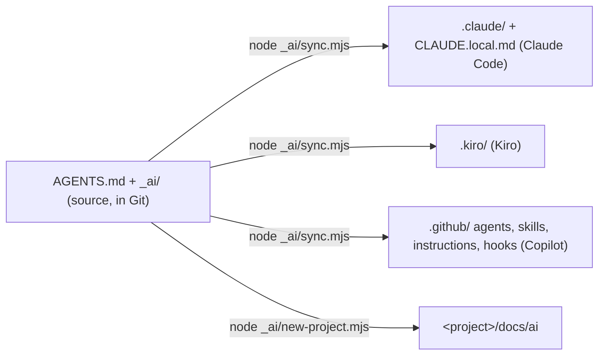

# AI setup

One set of rules, skills and helper agents for a workspace with several projects. The source is `AGENTS.md` and `_ai/`; `node _ai/sync.mjs` generates the files Claude Code, Kiro and GitHub Copilot read, for the tools each device uses.



## Install on a device

Requires Git and Node.js 22+ (the test command uses `node --test` globs).

```powershell
git clone https://github.com/GociuRadu/AI-Setup work; cd work
node _ai/sync.mjs home --tools claude,kiro     # home PC
node _ai/sync.mjs work --tools copilot,kiro    # work laptop
node --test "_ai/**/*.test.mjs"
```

Open the `work` folder (not a project folder) in VS Code, Claude Code or Kiro. `.ai-device.json` (local) remembers the profile and tools, so later runs need no arguments; pass them again to change. Dropping a tool deletes its generated files, `.claude/settings.local.json` included.

| Profile | Agent behavior | Set in the tools |
|---|---|---|
| `home` | Acts without asking, within `AGENTS.md` ([home.md](_ai/profiles/home.md)) | Kiro: Autopilot |
| `work` | Asks before anything but reads ([work.md](_ai/profiles/work.md)) | Kiro: Supervised; Claude Code and Copilot: approvals on |

| Tool | Generated files |
|---|---|
| `claude` | `.claude/`, `CLAUDE.local.md` |
| `kiro` | `.kiro/` |
| `copilot` | `.github/agents/`, `.github/skills/`, `.github/instructions/`, `.github/hooks/guard.json`, `.github/copilot-instructions.md` |

A sync replaces these paths whole; your other files under `.github/` (workflows, for example) stay. Do not select `claude` and `copilot` on the same device: Copilot also reads `.claude/` and `CLAUDE.md` files.

## Start a project

```powershell
node _ai/new-project.mjs <Name> --template app        # docs/ai only; clone the repo into <Name>/code/
node _ai/new-project.mjs <Name> --template data-eng   # also a local data-engineering skeleton in code/; run git init there
```

`--dest <dir>` creates the folder elsewhere; an existing folder is never overwritten. Fill `docs/ai/project.md` once (stack, commands, DEV and PRODUCTION names); the AI keeps the rest of `docs/ai/` current: `context.md` (state and open work), `memory.md` (decisions and non-obvious bugs), `plans/` and `reports/`.

## Daily use

Type a skill as `/<name>` or describe the task; the skill's description routes it. For design work, switch the chat model to Opus.

| Skill | Use it to |
|---|---|
| `/plan <goal>` | Design something or start a large task; writes a plan file |
| `/delegate <task>` | Split work across the helpers |
| `/review [review \| bug \| analyze \| debt] <scope>` | Review code, find a bug, explain a flow, list shortcuts |
| `/data <task>` | Tables, DDL, loads, pipelines, Spark notebooks |
| `/confluence-project <link> <change>` | Read or update a project Confluence page |
| `/learn <stage or topic>` | Study a project stage: industry standard, terms, interview questions |
| `/handoff` | Continue in a new chat |

Helpers are subagents the chat starts through `delegate`, each defined in [_ai/agents/](_ai/agents/): `scout` searches, `tester` runs tests, `worker` implements a spec, `reviewer` reviews, `challenger` gives a second opinion on a design choice.

## Safety layers

The rules are in [AGENTS.md](AGENTS.md). What enforces them:

| Layer | Claude Code | Kiro | Copilot |
|---|---|---|---|
| Guard hook | Yes | Yes | Yes; Preview, a timeout allows the call |
| Deny list | Yes | No | No |
| Safety rules as text | `AGENTS.md` | `AGENTS.md` | `AGENTS.md`, copied into `copilot-instructions.md` |
| English reminder on each prompt | Hook | Hook | Rule text only |

[_ai/hooks/guard.mjs](_ai/hooks/guard.mjs) runs before every shell, read and write tool call. It blocks writing SQL sent through a database client, the hard stops, `.env`-style files and `personal/`; if it cannot load, it blocks (fails closed). It sees only command text and paths, so code that opens its own connection is not checked, and an inline script whose text names a hard stop or `personal` is blocked too: put such a script in a file. Copilot is the weakest layer: on `work`, keep its approvals on.

## Layout

| Path | Purpose |
|---|---|
| [AGENTS.md](AGENTS.md) | Rules for every chat; helpers get the sections they list |
| `_ai/agents/` | Helpers; `_core.md` starts each one, `sections:` names the `AGENTS.md` sections it gets |
| `_ai/skills/` | The 6 skills above |
| `_ai/rules/` | Rules loaded by file path: Python, SQL, reports |
| `_ai/profiles/` | `home` and `work` |
| `_ai/tools/` | What differs per tool: Claude Code (in `CLAUDE.local.md`), Kiro, Copilot (in `copilot-instructions.md`) |
| `_ai/templates/` | Project skeletons (`common`, `app`, `data-eng`) and the report skeleton |
| [_ai/sync.mjs](_ai/sync.mjs) | Generates the selected tools' files; `--check` verifies they are current and every link resolves |
| [_ai/report.mjs](_ai/report.mjs) | Markdown → one HTML report; `--edit <file.html>` restores the Markdown |
| [_ai/new-project.mjs](_ai/new-project.mjs) | Creates a project folder from a template |
| `docs/` | Plans and reports about this setup |
| `.claude/`, `.kiro/`, `.github/`, `CLAUDE.local.md`, `.ai-device.json` | Generated and gitignored |

## Change the setup

1. Edit `AGENTS.md` or `_ai/`.
2. Run:
   ```powershell
   node _ai/sync.mjs
   node _ai/sync.mjs --check          # prints "in sync"
   node --test "_ai/**/*.test.mjs"
   ```
3. Start a new chat so the tools reload, then commit.

- **New skill:** `_ai/skills/<name>/SKILL.md` with `name` (same as the folder) and `description` (when to use it); link shared files by workspace path (`_ai/...`).
- **New helper:** `_ai/agents/<name>.md` with `name`, `description`, `model` (`haiku`, `sonnet`, `opus`), `tools` (`read`, `search`, `web`, `edit`, `execute`) and `sections`; add it to the `delegate` table.
- **`AGENTS.md` sections** copied into helpers must read right without the chat (a test rejects "this chat"). Renaming a section: update every `sections:` list (sync fails on an unknown name); keep `Databases`, whose anchor the `data` skill links.
- **New PRODUCTION host:** add it to the hard stops in [_ai/hooks/guard.mjs](_ai/hooks/guard.mjs) and its test.

## Sources

The Code rules in `AGENTS.md`, the `reviewer` checklist and the `debt` mode of `review` adapt [Ponytail](https://github.com/DietrichGebert/ponytail) 5.3.3 (`96608e0`, MIT, Copyright (c) 2026 DietrichGebert). Not taken: levels, hooks, the band, `gain`, `help`. To re-sync, diff upstream `skills/ponytail/SKILL.md` against the Code section.

The decision **Review** column in `memory.md` comes from the decision log in [chief-of-staff](https://github.com/alirezarezvani/claude-skills/tree/main/c-level-advisor/skills/chief-of-staff) (MIT); its routing and board-meeting parts were not taken.
