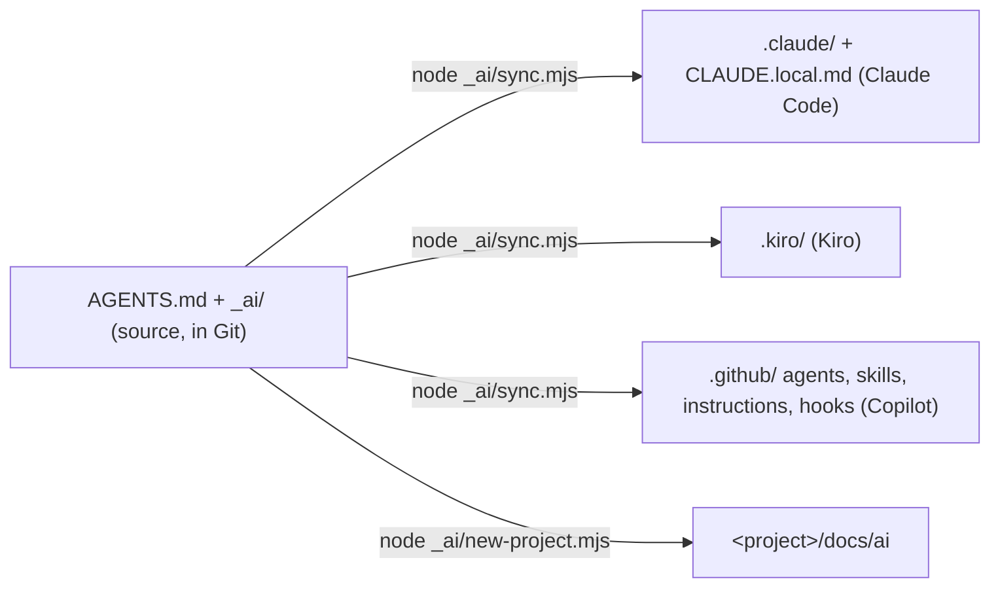

# AI setup

One set of rules, skills and helper agents for a workspace with several projects. The source lives in `AGENTS.md` and `_ai/`; `node _ai/sync.mjs` generates the files Claude Code, Kiro and GitHub Copilot read, for the tools each device uses.



## Install on a device

Requires Git and Node.js 22+ (the test command uses `node --test` globs).

```powershell
git clone https://github.com/GociuRadu/AI-Setup work; cd work
node _ai/sync.mjs home --tools claude,kiro     # home PC
node _ai/sync.mjs work --tools copilot,kiro    # work laptop
node --test "_ai/**/*.test.mjs"
```

Open the `work` folder (not a project folder) in VS Code, Claude Code or Kiro. The profile and tool list are saved in `.ai-device.json` (local), so later runs need no arguments; pass them again to change. Dropping a tool removes its generated files. Your own files under `.github/` (workflows, for example) are kept, but `.github/agents/`, `skills/`, `instructions/` and `copilot-instructions.md` are fully generated: a sync replaces anything you put there.

| Profile | Approvals | Kiro mode | Copilot |
|---|---|---|---|
| `home` | None, except the hard limits below | Autopilot | Your choice |
| `work` | Every action except reads asks first; no Git writes unless asked, never push | Supervised | Approvals on, no auto-approve |

| Tool | Generated files |
|---|---|
| `claude` | `.claude/`, `CLAUDE.local.md` |
| `kiro` | `.kiro/` |
| `copilot` | `.github/agents/`, `.github/skills/`, `.github/instructions/`, `.github/hooks/guard.json`, `.github/copilot-instructions.md` |

Do not select `claude` and `copilot` on the same device: Copilot also reads `.claude/` and `CLAUDE.md` files.

## Start a project

```powershell
node _ai/new-project.mjs <Name> --template app        # docs/ai only; clone the repo into <Name>/code/
node _ai/new-project.mjs <Name> --template data-eng   # also a local data-engineering skeleton in code/; run git init there
```

`--dest <dir>` creates the folder elsewhere; an existing folder is never overwritten.

Each project gets `docs/ai/`, which the AI reads and keeps current:

| File | Holds | Who updates it |
|---|---|---|
| `project.md` | Stack, commands, guardrails, asset index | You, once; the AI when assets change |
| `context.md` | Current state and open work, under 40 lines | The AI, whenever a task starts, finishes or blocks |
| `memory.md` | Decisions (with a **Review** date or trigger), lessons, non-obvious bugs | The AI; `plan` flags decisions whose review is due |
| `plans/` | One plan file per large task | The `plan` skill |
| `reports/` | HTML reports built by `node _ai/report.mjs` | The `review` and `data` skills, on request |

## Daily use

Chats run on Sonnet; switch the chat model to Opus for design, data models, migrations and hard debugging. Type a skill as `/<name>` or just describe the task; the description routes it.

| You want to | Use |
|---|---|
| Ask a question, make a small change | Normal chat |
| Design something or build a large task (3+ files, schema, auth, migration) | `/plan <goal>` |
| Split work across helpers from a normal chat | `/delegate <task>` |
| Review code, find a bug, explain a flow, list shortcuts | `/review [review \| bug \| analyze \| debt] <scope>` |
| Tables, DDL, loads, pipelines, Spark notebooks | `/data <task>` |
| Read or update a project Confluence page | `/confluence-project <link> <change>` |
| Continue in a new chat | `/handoff` |

### Skills

| Skill | What it does |
|---|---|
| `plan` | Reads the code and `memory.md`, writes `docs/ai/plans/YYYY-MM-DD-<topic>.md` (goal, Done when, options, steps, risks), runs `reviewer` on risky plans and `challenger` on expensive choices, then asks only the questions that change the design. |
| `delegate` | Sends the token-heavy work to helpers and runs each step through do → check → review → mark done from real output. 2 failed fix rounds stop the loop. |
| `review` | 4 modes. `review`: findings only, fixes nothing. `bug`: reproduces first, then tests ranked hypotheses. `analyze`: explains a file, flow or question. `debt`: lists shortcuts. Answers in chat; writes an HTML report when asked. |
| `data` | Data models, DDL, migrations, ingestion and load pipelines on Azure SQL, Synapse Spark or local SQL Server/PySpark. Drafts every write for you to run; records decisions and runbooks. |
| `handoff` | Prints one paste-ready brief for a new chat or another agent. Writes no files. |
| `confluence-project` | Reads, answers about or writes the project's Confluence pages. |

### Helpers

Helpers are subagents that start without this chat's context; the chat briefs them through `delegate`. Built-in subagents are denied.

| Helper | Model | Does | Edits files |
|---|---|---|---|
| `scout` | Haiku | Searches many files, long logs or the web; returns evidence | No |
| `tester` | Haiku | Runs tests and lint from `project.md`; returns pass/fail counts | No |
| `worker` | Sonnet | Implements a precise spec and its tests; makes no design choices | Yes |
| `reviewer` | Sonnet | Fresh-eyes review of a change, folder or plan | No |
| `challenger` | Sonnet | Second opinion on one expensive choice; picks its own option before reading yours | No |

## Rules and safety

[AGENTS.md](AGENTS.md) holds the rules every chat follows: replies, workspace files, autonomy, models, code, databases, hard stops and secrets. The **Databases**, **Hard stops** and **Secrets** sections apply in both profiles:

- **Databases:** read-only queries on local Docker and DEV only; every write, DDL or load is a draft with expected rows and a rollback. PRODUCTION: nothing, not even reads.
- **Hard stops:** production or staging, deploys, SSH, force-push and `down -v` run only by you.
- **Secrets:** no `.env`-style files or tokens; no customer data in docs or memory.

[_ai/hooks/guard.mjs](_ai/hooks/guard.mjs) enforces part of this before every shell, read and write tool call in all three tools: it blocks writing SQL sent through a database client, the hard stops, `.env` files (even when you name one; open it yourself) and `personal/`. It only sees command text and paths, so code that opens its own connection is not checked. Claude Code settings also deny the Hostinger `execute` tools and Atlassian `executeDestructive`.

**Copilot is weaker:** it gets no deny list, only the guard hook (a Preview feature that allows the call when it times out) and the rules as text in [_ai/tools/copilot.md](_ai/tools/copilot.md). On `work`, keep Copilot's approvals on. The English-reply reminder runs as a prompt hook in Claude Code and Kiro; Copilot has only the rule in `AGENTS.md`.

File rules in [_ai/rules/](_ai/rules/) load by path: [python.md](_ai/rules/python.md), [sql.md](_ai/rules/sql.md), [report.md](_ai/rules/report.md).

## Layout

| Path | Purpose |
|---|---|
| [AGENTS.md](AGENTS.md) | Core rules for every chat |
| `_ai/agents/` | Helper definitions; `_core.md` is prepended to each |
| `_ai/skills/` | The 6 skills above |
| `_ai/rules/` | Path-scoped rules for Python, SQL and reports |
| `_ai/profiles/` | `home` and `work` |
| `_ai/tools/` | Per-tool notes: Claude Code (added to `CLAUDE.local.md`), Kiro (name map), Copilot (name map and safety, in `copilot-instructions.md`) |
| `_ai/templates/` | Project skeletons (`common`, `app`, `data-eng`) and `report.md` |
| [_ai/sync.mjs](_ai/sync.mjs) | Generates the selected tools' files and the local profile files; `--check` verifies they are current, flags files of dropped tools and checks every link |
| [_ai/report.mjs](_ai/report.mjs) | Markdown → one HTML report; `--edit <file.html>` restores the Markdown |
| [_ai/new-project.mjs](_ai/new-project.mjs) | Creates a project folder from a template; never overwrites |
| [_ai/hooks/guard.mjs](_ai/hooks/guard.mjs) | Pre-tool guard for Claude Code, Kiro and Copilot |
| `docs/` | Plans and reports about this setup |
| `.claude/`, `.kiro/`, `.github/`, `CLAUDE.local.md`, `.ai-device.json` | Generated and gitignored; never edit |

## Change the setup

1. Edit `AGENTS.md` or `_ai/`, never the generated files.
2. Run:
   ```powershell
   node _ai/sync.mjs
   node _ai/sync.mjs --check          # prints "in sync"
   node --test "_ai/**/*.test.mjs"
   ```
3. Start a new chat so the tools reload, then commit.

- **New skill:** `_ai/skills/<name>/SKILL.md` with `name` (same as the folder) and `description` (when to use it); link shared files by workspace path (`_ai/...`).
- **New PRODUCTION host:** add it to the hard stops in [_ai/hooks/guard.mjs](_ai/hooks/guard.mjs) and its test.

## Sources

The Code rules in `AGENTS.md`, the `reviewer` checklist and the `debt` mode of `review` adapt [Ponytail](https://github.com/DietrichGebert/ponytail) 5.3.3 (`96608e0`, MIT, Copyright (c) 2026 DietrichGebert). Not taken: levels, hooks, the band, `gain`, `help`. To re-sync, diff upstream `skills/ponytail/SKILL.md` against the Code section.

The decision **Review** column in `memory.md` comes from the decision log in [chief-of-staff](https://github.com/alirezarezvani/claude-skills/tree/main/c-level-advisor/skills/chief-of-staff) (MIT); its routing and board-meeting parts were not taken.
