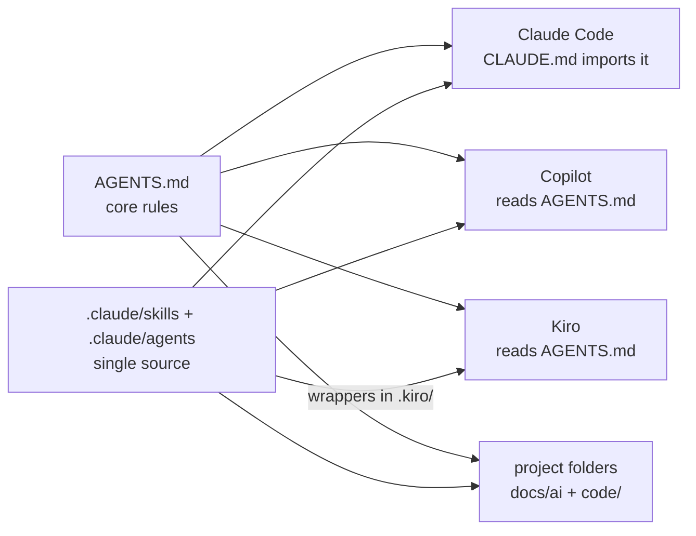

# AI Setup

One AI setup for a workspace with many projects, software engineering (`app`) and data engineering (`data-eng`) side by side. It works the same in Claude Code, GitHub Copilot (VS Code), Kiro and Codex. This repository is the workspace root: clone it, pick the device profile, open the folder.



## Install on a device

```powershell
git clone https://github.com/GociuRadu/AI-Setup work
cd work
node _ai/setup.mjs home    # or: work
```

`setup.mjs` also lists every MCP server configured for Claude Code, Kiro and VS Code, and how to turn each one off; it changes none of them. Then open the `work` folder (the workspace root, not a project or `code/` folder) in VS Code, Kiro or Claude Code. Requires Node.js 18 or newer for the guard hook and scripts.

| Profile | Behavior |
|---|---|
| `home` | Full autonomy: runs commands, tests, Docker and Git (feature branches) without asking. Kiro: Autopilot. |
| `work` | Asks before anything that is not a file read; Git writes only on request, never push. Kiro: Supervised. Also the default when no profile is set. |

Databases, secrets and hard stops are the same in both profiles: the agent only reads databases, never opens `.env` files, and never runs production, force-push or volume-deleting commands.

## Add a project

```powershell
node _ai/new-project.mjs Billing --template app        # then: git clone <url> Billing/code
node _ai/new-project.mjs SalesLoad --template data-eng # then: git init SalesLoad/code
```

Fill `<project>/docs/ai/project.md` (at least At a glance, Guardrails, Commands). Project folders are ignored by this repository; each project's code keeps its own Git repository in `code/`. `data-eng` includes a local Docker test environment: see `code/local/SETUP-WSL.md` and `code/local/README.md`.

## Daily use

Name the project or path in the request and say the goal, the scope and the expected result. No credentials or customer rows.

| Need | Use | Output |
|---|---|---|
| Question, small change in a few files | normal chat | answer or changes |
| Plan or design, risky path, 5+ files, research | just ask: the main agent plans and starts the helpers | plan or changes |
| Explain, document, write up a decision | `/analyze <scope>` | `docs/ai/reports/…-analyze-….md` |
| Review a change / audit a project | `/review [files]` / `/review audit` | chat / `docs/ai/reports/…-review-….md` |
| Something is wrong | `/bug <symptom>` | report with cause and proposed fix |
| Tables, DDL, loads, pipelines, Spark notebooks | `/data <task>` | changes, runbook and design record when new |
| Project Confluence page (link required) | `/confluence-project <link> <change>` | page title and new version |
| Smaller or larger code changes | `/ponytail lite\|full\|ultra\|off` | this chat only |
| Run the tests | "run the tests" | counts in chat (`tester`) |

The main agent works on Sonnet (Claude Code default in `.claude/settings.json`; pick it in Kiro and Copilot) and suggests Opus for design or hard debugging. Its helper rules are in `_ai/orchestration.md`, read only for bigger work. Helpers it starts on its own:

| Agent | Model | Does |
|---|---|---|
| `scout` | Haiku 5.5 | search in files, logs and the public web; long findings go to a report file |
| `worker` | Haiku 5.5 | bulk mechanical edits from an exact spec, several in parallel |
| `tester` | Haiku 5.5 | runs the project's tests and lint, reports counts |
| `reviewer` | Sonnet 5.5 | read-only review before handoff |

## Where results go

| Result | Location |
|---|---|
| Stable facts, commands, guardrails | `<project>/docs/ai/project.md` |
| Current state, open work | `<project>/docs/ai/context.md` |
| Decisions, lessons, bugs | `<project>/docs/ai/memory.md` |
| Reports, runbooks, design records | `<project>/docs/ai/reports/` |
| Code and tests | `<project>/code/` (the project's Git checkout) |

## Layout

| Path | Purpose | Read by |
|---|---|---|
| `AGENTS.md` | Core rules: responses, projects, helpers, databases, hard stops, secrets, Python, SQL | Copilot, Kiro, Codex; Claude through `CLAUDE.md` |
| `CLAUDE.md`, `.github/copilot-instructions.md`, `.kiro/steering/kiro.md` | Tool adapters: tool and model names only | one tool each |
| `.claude/skills/` | Skills, the single source | Claude, Copilot; Kiro through `.kiro/skills/` |
| `.claude/agents/` | Helpers `scout`, `worker`, `tester`, `reviewer` | Claude, Copilot; Kiro through `.kiro/agents/` |
| `.kiro/skills/`, `.kiro/agents/` | Generated wrappers that load the `.claude/` files | Kiro |
| `.claude/settings.json`, `.github/hooks/guard.json`, `.kiro/hooks/guard.json` | Wire the guard hook (and Claude's deny rules, Sonnet default, earlier auto-compact, Haiku for unpinned subagents) | one tool each |
| `_ai/orchestration.md` | Helper triggers, briefs, parallel rules, verification | main agent, only for bigger work |
| `_ai/hooks/guard.mjs` | Blocks writing SQL, hard stops and secret reads in every tool | all |
| `_ai/profiles/` | `home` and `work` permission profiles | through `_ai/setup.mjs` |
| `_ai/templates/` | Project skeletons `app` and `data-eng` | `_ai/new-project.mjs` |
| `_ai/check.mjs` | Self-check of the setup; `--fix` regenerates the Kiro wrappers | you |

## Tool notes

- Always open the workspace root: the hooks run `node _ai/hooks/guard.mjs` from there, and a tool started in a subfolder may not load the rules.
- Claude Code: open the workspace interactively once and accept the trust dialog; until then it ignores the `allow` rules in `.claude/settings.json`. Deny rules and the guard hook apply either way.
- Copilot (VS Code) reads `AGENTS.md`, `.claude/skills/` and `.claude/agents/` natively; the guard runs from `.github/hooks/guard.json`. If `AGENTS.md` is not loaded, turn on the `chat.useAgentsMdFile` setting.
- Kiro loads `.kiro/hooks/guard.json` in the IDE (1.0+) and CLI V3; the helpers also carry the guard as inline hooks, which Kiro CLI 2.x runs too.

## Change the setup

1. Edit the source: `AGENTS.md` for rules, `.claude/skills/<name>/SKILL.md` for a skill, `.claude/agents/<name>.md` for a helper, `_ai/profiles/` for permissions. Behavior is never per tool; a tool adapter only maps names.
2. Run `node _ai/check.mjs --fix` (regenerates the Kiro wrappers, checks links, headers, JSON and the guard tests), then `node _ai/check.mjs`.
3. After a profile change, run `node _ai/setup.mjs <profile>` again. Start a new chat session, then commit.

Adding a skill: create `.claude/skills/<name>/SKILL.md` with `name` and `description`, list it in the Skills section of `AGENTS.md` and run the check. If you copy text from an external repo, keep its license line at the top of the skill.
