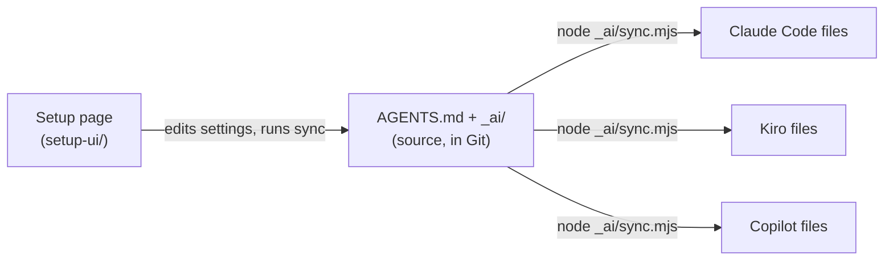

# AI Setup

One place to define how AI coding assistants work in this workspace: rules, skills, helper agents, models, MCP servers and safety checks. You edit [AGENTS.md](AGENTS.md) and `_ai/`; one command writes the matching files for **Claude Code**, **Kiro** and **GitHub Copilot**.



- [Start](#start) · [How it works](#how-it-works) · [Settings](#settings) · [Setup page](#setup-page) · [Skills and helpers](#skills-and-helpers) · [Projects](#projects) · [Safety](#safety) · [Maintain](#maintain) · [Credits](#credits)

## Start

Needs Git and Node.js 22 or newer.

```powershell
git clone https://github.com/GociuRadu/AI-Setup work; cd work
node _ai/sync.mjs home --tools claude,kiro     # e.g. home PC
node _ai/sync.mjs work --tools copilot,kiro    # e.g. work laptop
```

Then open the `work` folder (not a project subfolder) in your editor. The choice is saved in `.ai-device.json`, so later runs are just `node _ai/sync.mjs`.

> Do not turn on `claude` and `copilot` together: Copilot also reads Claude's files, so hooks run twice. Sync warns when both are on.

## How it works

- **Source:** `AGENTS.md` and `_ai/` are the only files you edit; they are in Git.
- **Generated:** sync writes each tool's files and replaces them whole on every run. Never edit them; `node _ai/sync.mjs --check` reports any that are missing, stale or extra.
- **Kept:** your own files next to them stay: other files in `.github/`, your keys in `.vscode/settings.json`, MCP servers you added in a tool, and your rules in Kiro's `permissions.yaml`.

| Tool | Generated files |
|---|---|
| `claude` | `.claude/`, `CLAUDE.local.md`, `.mcp.json` |
| `kiro` | `.kiro/` and a rule block in `~/.kiro/workspace-roots/<hash>/permissions.yaml` |
| `copilot` | `.github/agents/`, `.github/skills/`, `.github/instructions/`, `.github/hooks/guard.json`, `.github/copilot-instructions.md`, `.vscode/mcp.json`, keys in `.vscode/settings.json` |

**Profiles** decide how much runs without asking:

| Profile | Runs without asking | Asks first |
|---|---|---|
| `home` ([home.md](_ai/profiles/home.md)) | Everything within [AGENTS.md](AGENTS.md) | Only what the guard asks about (deletes, Git writes, external CLI) |
| `work` ([work.md](_ai/profiles/work.md)) | Reads, searches, helpers, edits in the workspace, tests | Deletes, edits outside the workspace, Git writes, external CLI and network, mutating MCP tools |

## Settings

3 files hold every setting. After a change run `node _ai/sync.mjs`, or use the [setup page](#setup-page).

| File | Shared? | Holds |
|---|---|---|
| [_ai/models.json](_ai/models.json) | Yes, in Git | Model per tier and per helper, per tool |
| [_ai/mcp.json](_ai/mcp.json) | Yes, in Git | MCP servers |
| `.ai-device.json` | No, this device | Profile, tools, per-tool switches, local model overrides, Obsidian vault |

### Models

Helpers ask for a tier, not a model: `fast` (`scout`, `tester`), `balanced` (`worker`, `reviewer`, `challenger`) or `deep`. Each tool maps tiers to its own model IDs:

```json
{ "copilot": {
    "tiers": { "fast": "Claude Haiku 5.5 (copilot)", "balanced": "Claude Sonnet 5.5 (copilot)", "deep": "Claude Opus 5.5 (copilot)" },
    "agents": { "tester": "Gemini 4 Neon (copilot)" } } }
```

- **`agents`:** a model for one helper, overriding its tier.
- **`available`:** model IDs the setup page suggests.
- **`claude.default` / `claude.subagentDefault`:** Claude Code's chat model and helper model.
- **One device only:** a `"models"` block of the same shape in `.ai-device.json`.

### Per-tool switches

In `.ai-device.json`, `perTool` turns things off for one tool; anything not listed is on. Sync rejects unknown names.

```json
{ "profile": "home", "tools": ["claude", "kiro"],
  "perTool": {
    "kiro":   { "skillsOff": ["learn"] },
    "claude": { "mcpOff": ["atlassian"] } } }
```

- **`hooks`:** `guard`, the one hook (the safety check). With `guard` off, that tool can read `.env` files and `personal/` through the shell, write SQL and run hard stops; sync prints `guard: off for <tool>`.
- **`skillsOff`:** skills left out of that tool.
- **`mcpOff`:** MCP servers left out of that tool.

### MCP servers

[_ai/mcp.json](_ai/mcp.json) lists each MCP server once; sync writes it in each tool's format (`.mcp.json`, `.kiro/settings/mcp.json`, `.vscode/mcp.json`).

```json
{ "servers": {
    "atlassian": { "description": "Jira, Confluence and Compass", "type": "http", "url": "https://mcp.atlassian.com/v2/mcp" },
    "example":   { "type": "stdio", "command": "npx", "args": ["-y", "<package>"], "env": { "API_TOKEN": "${EXAMPLE_TOKEN}" } } } }
```

- **No secrets in the file:** an `env` or `headers` value must be `${NAME}` or `Bearer ${NAME}`, and a `url` has no password or literal query value; sync refuses anything else. `args` are not checked, so pass secrets through `env`. Atlassian signs in with OAuth inside each tool.
- **Your servers stay:** sync changes only the servers it owns (listed in `_ai/mcp.json`, or written by its last run); servers you add in a tool are kept. Delete a server from `_ai/mcp.json` and the next sync removes it from the tools.
- **claude.ai connectors** (Atlassian, Gmail, ... in your claude.ai account) reach Claude Code through your account, not this file. If a connector already covers a server, turn that server off for `claude`.
- **First use:** Claude Code asks once to approve the servers in `.mcp.json`.

### Obsidian vault

Paste the vault folder in the setup page (Obsidian section) and **Apply**; it is saved as `"obsidian": { "vault": "<full path>" }` in `.ai-device.json`.

- **Access:** the tools read and edit the vault. `Personal` and `.mdenc` notes are denied, and the guard blocks commands that name them or search the whole vault; it does not see a shell variable or a wildcard from another folder.
- **`/learn`** writes its notes in `Learn` and its pictures in `Files`; `node _ai/vault.mjs check "<Topic>"` checks links, pictures, diagrams and length.
- **Folder missing:** sync warns and leaves vault access out.

## Setup page

A local web page for the same settings: tools, profile, models, Obsidian vault, hooks, skills and MCP servers per tool. It shows what will change, saves `_ai/models.json` and `.ai-device.json`, then **Apply** runs sync and shows its output.

```powershell
cd setup-ui; npm install
npm run setup-ui   # build, then open http://127.0.0.1:4319
```

- **Local only:** it listens on `127.0.0.1`, accepts only local addresses, and needs a per-start token, so other websites cannot call it.
- **Not AI context:** searches skip `setup-ui/` (root `.ignore`), and the guard asks you before an agent reads it or runs anything in it.
- **Develop it:** `npm test` (run from PowerShell with a `C:\` path; vitest fails from Git Bash's `/c/` path); `npm run api` plus `npm run dev` for hot reload.

## Skills and helpers

Type `/<name>`, or describe the task and the matching skill starts. Use Opus for design, data models, migrations, public interfaces and hard debugging; Sonnet for the rest.

| Skill | Use it to |
|---|---|
| `/pplan <goal>` | Plan a large task (3+ files, schema, auth, shared interfaces) in a plan file |
| `/delegate <task>` | Split work across the helpers below |
| `/review [review \| bug \| analyze \| debt] <scope>` | Review a change, find a bug's cause, explain code or list shortcuts |
| `/data <task>` | Design or review data models, DDL, migrations, loads and Spark notebooks |
| `/confluence-project <link> <change>` | Read or update a project's Confluence page |
| `/learn <stage or topic>` | Write linked study notes in the Obsidian vault, with diagrams and interview questions |
| `/retro [topic]` | Turn a session's mistakes or lessons into 1-2 line rule updates |
| `/handoff` | Print a brief to continue in a new chat |
| `/clean [--days 7] [--reports]` | List stale logs, caches and transcripts; delete after you confirm |
| `/ui-ux-pro-max <ui task>` | Get UI/UX guidance (styles, colors, fonts, accessibility); needs Python 3 |

The 10 skills above hand work to 5 helpers, defined in `_ai/agents/` and started only through `/delegate`:

| Helper | Does | Can edit? |
|---|---|---|
| `scout` | Searches files, logs or the web | No |
| `tester` | Runs tests, linters and long commands | No |
| `worker` | Writes code and tests from a precise spec | Named files only |
| `reviewer` | Reviews a change for bugs, data loss, bloat | No |
| `challenger` | Gives a second opinion on a costly choice | No |

## Projects

Each project has its own folder: `<Name>/code/` is its Git repo, `<Name>/docs/ai/` holds the AI's notes.

```powershell
node _ai/new-project.mjs <Name> --template app        # notes only; clone the repo into <Name>/code/
node _ai/new-project.mjs <Name> --template data-eng   # notes + a local data-engineering skeleton
```

Fill `docs/ai/project.md` once (stack, commands, DEV/PRODUCTION names). The AI keeps `context.md` (current state), `memory.md` (decisions and tricky bugs), `plans/` and `reports/` up to date. `--dest <dir>` creates the folder elsewhere; existing folders are never overwritten.

## Safety

[AGENTS.md](AGENTS.md) sets the rules; 3 layers enforce them:

| Layer | What it does |
|---|---|
| Guard hook ([_ai/hooks/guard.mjs](_ai/hooks/guard.mjs)) | Runs before each tool call in all 3 tools. Blocks writing SQL, PRODUCTION/staging commands, force-push, `.env` files and `personal/`. It is the only layer that asks, and only on what leaves the machine or cannot be undone, by profile ([work](_ai/profiles/work.md), [home](_ai/profiles/home.md)): pushes, work-discarding Git, wide or outside deletes, outside edits, loaders, publishing, deleting MCP tools, `setup-ui/`; on work also cloud CLIs, writing `gh`/HTTP calls and shared MCP writes. If it cannot load, it blocks. |
| Allow and deny lists | Claude Code settings, Kiro `permissions.yaml` and Copilot auto-approve rules allow the tools and deny the same secret files and hard stops, so they never ask twice; Kiro keeps ask rules for MCP writes, and reads outside the workspace (credential stores denied) and the temp folder are allowed. Claude Code also denies each MCP server's `executeDestructive`. |
| Written rules | `AGENTS.md` plus each tool's own instructions file. |

**Known limits:** a script that opens a database connection itself is not inspected, only the command; a command that only mentions a hard stop or `personal` is blocked too (put it in a file); Copilot hooks are still a Preview feature.

## Maintain

1. Edit `AGENTS.md` or `_ai/`, never the generated files.
2. Check:
   ```powershell
   node _ai/sync.mjs
   node _ai/sync.mjs --check
   node --test "_ai/**/*.test.mjs"
   ```
3. Start a new chat so the tools reload, then commit. GitHub Actions ([test.yml](.github/workflows/test.yml)) runs the same checks and the setup page tests on every push.

| To | Do |
|---|---|
| Add a skill | `_ai/skills/<name>/SKILL.md` with `name` = folder name and a `description` that says when to use it; add a row to the skills table and update the count (tests check both) |
| Add a helper | `_ai/agents/<name>.md` with `name`, `description`, `model` (tier), `tools` (`read`, `search`, `web`, `edit`, `execute`), `sections`; register it in `/delegate` |
| Add an MCP server | An entry in [_ai/mcp.json](_ai/mcp.json), secrets as `${NAME}` |
| Change models | [_ai/models.json](_ai/models.json), or `"models"` in `.ai-device.json` for one device |
| Rename an `AGENTS.md` section | Update every `sections:` list in `_ai/agents/` and `_ai/tools/` (sync fails on unknown names) |
| Add a PRODUCTION host | [_ai/hooks/guard.mjs](_ai/hooks/guard.mjs) and its test |

| Path | Holds |
|---|---|
| `_ai/agents/`, `_ai/skills/`, `_ai/rules/`, `_ai/profiles/`, `_ai/tools/` | Helpers, skills, file-type rules, profiles, per-tool notes |
| `_ai/hooks/` | Guard and English hook |
| `_ai/templates/` | Project skeletons and the report template |
| [_ai/sync.mjs](_ai/sync.mjs), [_ai/new-project.mjs](_ai/new-project.mjs), [_ai/report.mjs](_ai/report.mjs), [_ai/clean.mjs](_ai/clean.mjs), [_ai/vault.mjs](_ai/vault.mjs) | Sync, new project, Markdown-to-HTML report, cleanup, study note check |
| [setup-ui/](setup-ui/) | Setup page |
| `docs/` | Plans and reports about this setup, while they are in use |

## Credits

- Code rules in [AGENTS.md](AGENTS.md), the `reviewer` checklist and `/review debt` adapt [Ponytail](https://github.com/DietrichGebert/ponytail) 5.3.3 (`96608e0`, MIT, Copyright (c) 2026 DietrichGebert).
- The decision **Review** column in `memory.md` is adapted from [chief-of-staff](https://github.com/alirezarezvani/claude-skills/tree/main/c-level-advisor/skills/chief-of-staff) (MIT).
- `_ai/skills/ui-ux-pro-max/` is [UI UX Pro Max](https://github.com/nextlevelbuilder/ui-ux-pro-max-skill) (`2de1134`, MIT, Copyright (c) 2024 Next Level Builder), without `scripts/tests/`.
