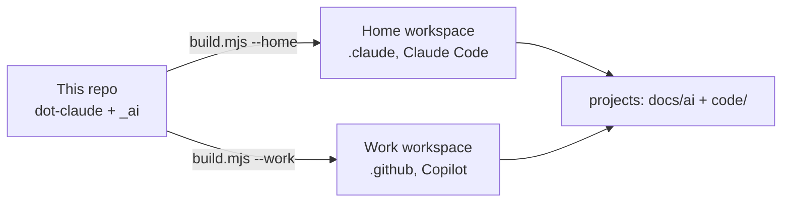

# AI Setup

One AI setup for a multi-project workspace, the same at home (Claude Code) and at work (GitHub Copilot). Only the permissions differ: at home the agent acts without asking, at work it asks first. Database rules are the same everywhere: the agent only reads.

| Read | For |
|---|---|
| [HOW-TO-USE.md](HOW-TO-USE.md) | Daily use: which skill or agent, where results go |
| [_ai/README.md](_ai/README.md) | Layout, build script, maintenance |
| [_ai/SOURCES.md](_ai/SOURCES.md) | External sources and licenses |

