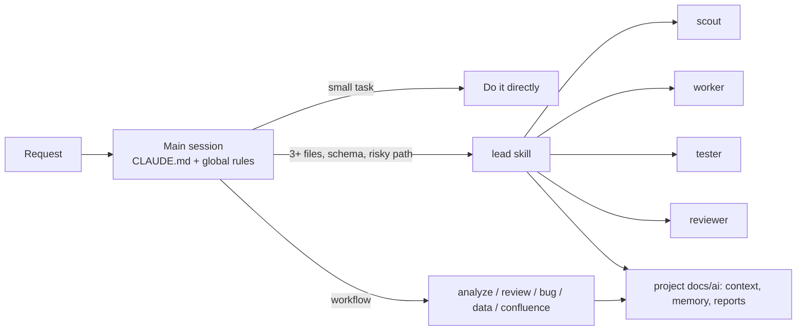

# AI Setup

Claude Code setup for a multi-project workspace (`projects`): global rules, an orchestrator skill (`lead`), four Haiku helper agents and domain skills. Project folders are not versioned here.

| Read | For |
|---|---|
| [HOW-TO-USE.md](HOW-TO-USE.md) | Daily use: start, which skill/agent, where results go, troubleshooting |
| [_ai/README.md](_ai/README.md) | Layout, how the pieces connect, maintenance |
| [_ai/SOURCES.md](_ai/SOURCES.md) | External sources and licenses |
| [work/HOW-TO-USE.md](work/HOW-TO-USE.md), [work/STRUCTURE.md](work/STRUCTURE.md) | Work setup (GitHub Copilot, strict permissions, anonymized) |

