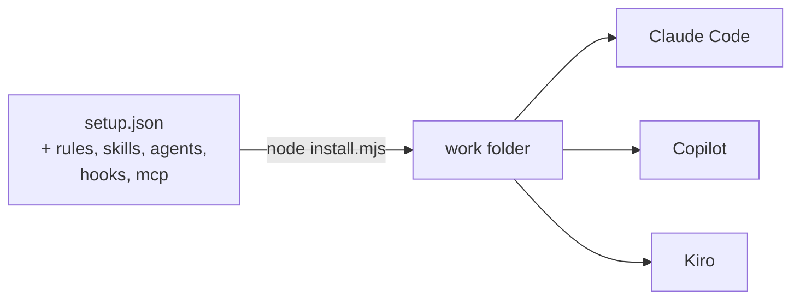

# AI Setup

One repo that sets up **Claude Code**, **GitHub Copilot** (VS Code) and **Kiro** to work the same way: the same rules, skills, helper agents and safety guard, installed by one script from one list.



- **One source:** edit this repo, never the generated files. Rerun the install after every `git pull`.
- **One list:** [setup.json](setup.json) names every part, all on; set one to `false` and the next run removes it.
- **Safe by default:** a guard runs before every tool call in all 3 tools; hard stops are blocked, risky actions ask first.

## Contents

[Quick start](#quick-start) · [What you get](#what-you-get) · [Where files go](#where-files-go) · [Configure](#configure) · [Safety](#safety) · [Projects](#projects) · [Maintain](#maintain) · [Credits](#credits)

## Quick start

Needs Git and Node.js 22 or newer; no npm packages.

```powershell
cd C:\Users\<you>\Desktop\work                       # the folder you open in VS Code and Kiro
git clone https://github.com/GociuRadu/AI-Setup.git
node AI-Setup/install.mjs --vault "C:\path\to\vault"  # first run; later runs need no flags
```

Then open the `work` folder (not a project inside it) and start a new chat in each tool.

| Flag | Does |
|---|---|
| `--dry-run` | Lists every change without making it |
| `--vault <folder>` | The Obsidian vault the `obsidian` skill writes to; saved for later runs |
| `--work <folder>` | Installs into another folder than the repo's parent |

The install skips tools the device lacks, deletes only files it wrote itself (listed in `work/.ai-device.json`), and moves any other file at a path it needs to `work/.ai/backup/`. A second run changes nothing.

## What you get

### Skills

Type `/<name>`, or describe the task and the matching skill starts.

| Skill | Use it to |
|---|---|
| `/pplan` | Plan before building: it asks the questions that change the design, researches the options, writes one plan file |
| `/review` | Review a change, find a bug's cause, explain code, or list shortcuts (`review`, `bug`, `analyze`, `debt`) |
| `/debate` | Get 2 opposing second opinions on a major decision, then one comparison table |
| `/data` | Design or review data models, DDL, migrations, loads and Spark notebooks |
| `/obsidian` | Write or edit vault notes, bases and canvases; researched study notes in `Learn` |
| `/confluence-project` | Read or update a project's Confluence page |
| `/ui-ux-pro-max` | UI and UX guidance: styles, colours, fonts, accessibility (needs Python 3) |
| `/playwright` | Test your own web app from the shell (needs `playwright-cli`) |
| `/handoff` | Update `context.md` and print a short brief for a new chat |
| `/improve` | Turn repeated failures into the smallest change to this setup |
| `/skill-creator` | Write and test a new skill |

### Helpers

The main agent is the only one that writes. Helpers are read-only and run in their own context, several in parallel; they return a short report.

| Helper | Does | Model tier |
|---|---|---|
| `tester` | Runs suites, lints and builds; returns counts and the failing lines word for word | `fast` |
| `researcher` | Searches many files, long logs or the web; returns evidence with paths or URLs | `balanced` |
| `reviewer` | Fresh-eyes review of a risky change against its goal | `balanced`, high effort |
| `challenger` | Second opinion on a costly choice; also the 2 voices of `/debate` | `deep`, high effort |

### Always-on rules

[rules/always.md](rules/always.md), about 40 lines, loaded in every chat: replies (answer first, short, plain), honesty (claim only what was read or run), code (smallest complete change), project state, helpers and safety. SQL and Python rules load only for `.sql` and `.py` files.

## Where files go

| Part | Source | Claude Code | Copilot | Kiro |
|---|---|---|---|---|
| Always-on rules | `rules/always.md` | `CLAUDE.md` → `AGENTS.md` | `AGENTS.md` | `AGENTS.md` |
| SQL, Python rules | `rules/sql.md`, `python.md` | `.claude/rules/` | `.github/instructions/` | `.kiro/steering/` |
| Skills | `skills/<name>/` | `.claude/skills/` | `.github/skills/` | `.kiro/skills/` |
| Helpers | `agents/<name>.md` | `.claude/agents/` | `.github/agents/` | `.kiro/agents/` |
| Guard | `hooks/` | `~/.claude/settings.json` | `.github/hooks/guard.json` | `.kiro/hooks/guard.json` |
| MCP | `mcp/atlassian.json` | `.mcp.json` | `.mcp.json` | `.kiro/settings/mcp.json` |

All paths except `~/` are inside the work folder; the guard and the project templates are copied to `work/.ai/`. Outside it, the install changes only its own keys in 3 files the tools require:

| File | Keys |
|---|---|
| `~/.claude/settings.json` | auto mode, the guard hook, deny rules, auto memory off, no Concise output style |
| VS Code User `settings.json` | hooks on, Copilot ignores `.claude/` files and hooks, local memory off, never-auto-approve rules |
| `~/.kiro/settings/permissions.yaml` | deny rules for secrets, `personal/`, encrypted notes and hard stops |

## Configure

Everything is in [setup.json](setup.json). After a change, rerun `node install.mjs`.

```json
{
  "skills": { "debate": false },
  "agents": { "reviewer": { "on": true, "tier": "balanced", "effort": "high" } },
  "models": { "balanced": { "claude": "sonnet", "copilot": "claude-sonnet-5.5", "kiro": "claude-sonnet-5.5" } }
}
```

- **Models:** each helper names a tier; `models` maps the tier to a model ID per tool. One device can give one helper another model in `work/.ai-device.json`: `"models": { "reviewer": { "copilot": "<model id>" } }`.
- **Built-ins turned off** (`off`), because this setup replaces them: Claude auto memory, Claude's Concise output style, Copilot local memory, Copilot reading `.claude/` files, and the retired GitHub and Playwright MCP servers. Kiro's memory is off by default; Copilot's cloud memory is a GitHub account setting. Review the list after vendor updates.

## Safety

| Layer | What it does |
|---|---|
| Guard ([hooks/guard.mjs](hooks/guard.mjs)), all 3 tools | **Blocks** writing SQL, anything on PRODUCTION or staging, force-push, `docker compose down -v`, SSH, Hostinger `execute`, Atlassian `executeDestructive`, `.env` files, the `personal/` folder and encrypted `.mdenc` notes. **Asks** before `git push`, Git that discards work, deletes outside the workspace, of a whole project or in the vault, the vault's `Personal/`, publishing, data loaders, `az`, `kubectl`, `helm`, `terraform`, writing `gh` or HTTP calls, and writes to shared MCP servers; in Kiro these are blocked instead, and you run them, because a Kiro allow rule can approve the ask without showing it. If it fails, or its input is not JSON, it blocks. |
| Tool settings | Claude Code auto mode and deny rules; Copilot never-auto-approve rules (Copilot runs a call when a hook times out); Kiro deny rules |
| Rules | The safety section of [rules/always.md](rules/always.md): databases are read-only, every write is a draft with a rollback |

Known limit: the guard reads the command text and file paths, so code that opens its own database connection is not seen.

## Projects

Each project lives in `work/<project>/`, with its Git repo in `<project>/code/` and the AI's notes in `<project>/docs/ai/`:

| File | Holds |
|---|---|
| `project.md` | Stack, commands, DEV and PRODUCTION names; written once |
| `context.md` | Current state and open work, kept up to date by the AI |
| `memory.md` | Decisions and non-obvious bugs |
| `plans/`, `reports/` | Plans from `/pplan`, reports from `/review` |

Missing files are created from [templates/](templates/) (`app` or `data-eng`).

## Maintain

```powershell
node --test           # 41 tests: install, guard, vault checker, report builder
node install.mjs      # apply the change, then start a new chat in each tool
```

- **Add a skill:** `skills/<name>/SKILL.md` (`name` = folder name, a description that says what and when, under 500 lines) and an entry in `setup.json`; the tests fail if either is missing.
- **Block something new:** add the check to `hooks/guard.mjs` with a test, as a regex on the call.
- **Decisions and state:** [docs/ai/memory.md](docs/ai/memory.md), [docs/ai/context.md](docs/ai/context.md); the full decision set: [docs/ai/plan.md](docs/ai/plan.md); smoke test per tool: [docs/ai/smoke.md](docs/ai/smoke.md).

CI runs `node --test` on Windows on every push ([.github/workflows/test.yml](.github/workflows/test.yml)).

## Credits

- Code rules follow [Ponytail](https://github.com/DietrichGebert/ponytail) 5.3.3 (MIT).
- `skills/obsidian/bases*.md` and `canvas*.md`: [kepano/obsidian-skills](https://github.com/kepano/obsidian-skills) `9c9560a` (MIT, Copyright (c) 2026 Steph Ango).
- `skills/playwright/`: [microsoft/playwright-cli](https://github.com/microsoft/playwright-cli) `dc5f4d5` (Apache-2.0, see its LICENSE).
- `skills/skill-creator/`: [anthropics/skills](https://github.com/anthropics/skills) `e4bb5d9` (see its LICENSE.txt).
- `skills/ui-ux-pro-max/`: [UI UX Pro Max](https://github.com/nextlevelbuilder/ui-ux-pro-max-skill) `2de1134` (MIT, Copyright (c) 2024 Next Level Builder).
- The decision Review column in `memory.md` is adapted from [chief-of-staff](https://github.com/alirezarezvani/claude-skills/tree/main/c-level-advisor/skills/chief-of-staff) (MIT).
