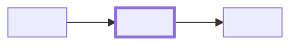

<!-- Learn report skeleton, plain Markdown. Visible text <= 600 words: depth goes into 
 blocks (not counted). Diagrams: Mermaid. Delete unused blocks; replace every <...>. -->
# Learn: <stage or topic>
| Date | Project | Stage |
|---|---|---|
| YYYY-MM-DD | <project> | <n of N> |

**Bottom line:** <what this stage exists to do and what it produces, in 1-2 sentences>

<!-- Headline numbers: only real, sourced figures (adoption %, survey share); omit the table when none exist. -->
| <label> | <label> | <label> |
|---|---|---|
| <number> | <number> | <number> |

## <Stage> sits between <previous> and <next>

| In | Out (artifacts) | Who |
|---|---|---|
| <what it needs> | <documents or decisions it produces> | <roles: PO, BA, tech lead...> |

Deep dive: what the stage does, step by step

1. <step, with the named technique>
2. <step>

## Teams pick one of <N> approaches; <the default> is the default
| Approach | Use when | Trade-off | Status |
|---|---|---|---|
| <name> | <context> | <what you give up> | <standard / common / growing / niche / legacy> |

Deep dive: why each approach exists

<one short paragraph per approach: the problem it solves, a named company or system that uses it, the source>

## Speak the language: <K> terms carry every meeting
| Term | Means | Say it like |
|---|---|---|
| <term> | <plain words> | "<a sentence a mid-level engineer would say>" |

## <This project> shows the stage: <one-line lesson>
| Before | After |
|---|---|
| <vague or naive version from this project> | <the version this stage produces> |

## <Most common mistake> costs the most
| Mistake | Why it hurts | Do instead |
|---|---|---|
| <mistake> | <consequence> | <fix> |

## Answer these before opening the answers
1. <definition question>
2. <compare question: X vs Y>
3. <apply question: in this project, how would you...>
4. <interleaved question mixing an earlier stage's term>
5. <senior follow-up: what breaks if...>

Answers: try first, then open

1. **Claim:** <answer>. **Why:** <reason>. **Example:** <from this project>. **Trade-off:** <cost>.

Evidence

| Fact | Source | Year |
|---|---|---|
| <fact> | <source as a Markdown link to its URL> | <year> |

Left out: <what was cut and why, 1 line>. **U** items: <what would confirm them>.

