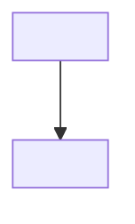

<!-- Delete this line, unused blocks and properties; replace every <...>. -->
> [!abstract] Bottom line

```mermaid
flowchart TD
  A[<input>] --> B[<this stage>]
  B --> C[<output>]
```

> <what this stage exists to do and what it produces>

Before: [[<earlier topic>]]. Next: [[<later topic>]]. Order: [[Learning map]].

## <Stage> sits between <previous> and <next>

| In | Out | Who |
|---|---|---|
| <what it needs> | <artifacts> | <roles> |

> [!info]- Step by step
> 1. <step, with the named technique>

## <K> terms carry every meeting
| Term | Means |
|---|---|
| [[<Term>]] | <plain words, at most 12> |

## <The default approach> is the default; <exception> when <condition>
| Approach | Use when | Trade-off | Status |
|---|---|---|---|
| <name> | <context> | <what you give up> | <status>[^1] |

![[<topic> - <what>.svg|480]]

<one sentence: what the picture shows>

## <Project> shows it: <lesson>
| Before | After |
|---|---|
| <naive version> | <what this stage produced, with its decision number> |

> [!example]- The real decision
> <what was decided, why, what it cost>

## <Most common mistake> costs the most
| Mistake | Why it hurts | Do instead |
|---|---|---|
| <mistake> | <consequence> | <fix> |

## Answer before you open
> [!question]- 1. <definition>
> **Claim:** <answer>
> **Why:** <reason>
> **Example:** <from the project>
> **Trade-off:** <cost>

> [!question]- 2. <compare X and Y>
> ...

> [!question]- 3. <apply it to the project>
> ...

> [!question]- 4. <mixes [[earlier term]]>
> ...

> [!question]- 5. <senior follow-up: what breaks if...>
> ...

## The terms connect like this

- [[<Term>]] <verb> [[<Term>]]

> [!warning]- Not verified
> <fact>: <what would confirm it>. Left out: <what and why>.

[^1]: [<title>](https://<url>), <year>
