<!-- Delete this line, unused blocks and properties; replace every <...>. Examples stay generic: no project, repo or ticket names. Every line must be something the reader will do, say or be asked. -->
> [!abstract] Bottom line

```mermaid
flowchart TD
  A[<input>] --> B[<this topic>]
  B --> C[<output>]
```

> <what this topic is for and what you do with it>

Before: [[<earlier topic>]]. Next: [[<later topic>]]. Order: [[Learning map]].

## 1. <Mental model in one line>

| <Part> | <Means> |
|---|---|
| <part> | <plain words, at most 12> |

## 2. <Daily use runs in this order>
1. <step>: `<command>`

## 3. <The default approach> is the default; <exception> when <condition>
| Approach | Use when | Trade-off | Status |
|---|---|---|---|

```mermaid
stateDiagram-v2
  [*] --> <state>
```

| <name> | <context> | <what you give up> | <status> (<year>) |

## 4. <Situations not covered above have a fixed sequence>
| Situation | Steps |
|---|---|
| <situation> | <steps> |

## 5. <Most common mistake> costs the most
| Mistake | Why it hurts | Do instead |
|---|---|---|
| <mistake> | <consequence> | <fix> |

## 6. Glossary: words no section explains
| Term | Means |
|---|---|
| <term> | <plain words> |

## In my own words

