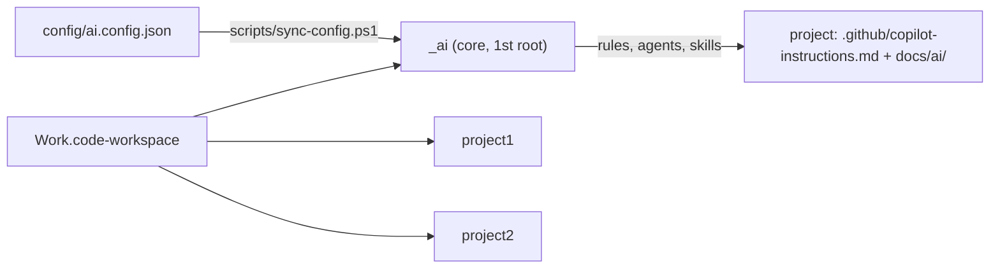

# AI core (`_ai`)

Central GitHub Copilot setup for the `Work` workspace. `_ai` holds the shared rules, agents and skills; each project root holds only its own facts (`docs/ai/`). User guide: [HOW-TO-USE.md](../HOW-TO-USE.md).



## Layout

| Path | Purpose |
|---|---|
| `.github/instructions/global.instructions.md` | All hard rules and formats (the only place to edit them) |
| `.github/instructions/python.instructions.md`, `sql.instructions.md` | Language rules (`**/*.py`, `**/*.sql`) |
| `.github/hooks/command-approval.json` | Auto-allows standalone and piped read-only file inspection across paths/types; asks for writes, deletes, redirects, chaining, and code execution |
| `.github/agents/` | `lead` (user-invocable, runs on the picked model), helpers `scout`, `worker`, `tester`, `reviewer` (Haiku or GPT-6 Luna) |
| `.github/skills/` | `analyze`, `review`, `bug`, `data`, `confluence`, `ponytail` |
| `config/ai.config.json` | Agent models and ponytail level |
| `scripts/` | `sync-config.ps1` (apply config), `new-project.ps1` (add a project), `sync-to-vault.ps1` (anonymized, code-free copy to the Obsidian vault; local only) |
| `templates/project/` | Skeleton for a new project |
| `SOURCES.md` | External origins and licenses |

Project module: `.github/copilot-instructions.md` (what to read) and `docs/ai/` with `project.md` (facts, commands, review focus), `context.md` (current state), `memory.md` (decisions, lessons, bugs), `reports/` (all generated files).

## Maintenance

```powershell
& '.\_ai\scripts\new-project.ps1' -Name <Project> [-Adopt] [-WhatIf]   # add a project, never overwrites
& '.\_ai\scripts\sync-config.ps1' [-WhatIf]                          # after editing ai.config.json
```

- **Vault backup:** `& '.\_ai\scripts\sync-to-vault.ps1' [-WhatIf]` mirrors the AI setup (plus repo memory, MCP template, local Docker test setup, CI/CD files) to `ObsidianVault\Me\Code\Setup\work` as `project1`/`project2`; no application code. Obsidian Sync skips dot-prefixed names, so the vault stores them as `dot-<name>` (`.github` -> `dot-github`); restore with `Get-ChildItem -Recurse -Force | Where-Object Name -like 'dot-*' | Rename-Item -NewName { '.' + $_.Name.Substring(4) }` (deepest first).
- **Add a skill:** `.github/skills/<name>/SKILL.md` (`name` = folder, lowercase-hyphen; `description` says when to use it). Prefer extending an existing skill over adding one. Record external sources in `SOURCES.md`.
- After any change: reload VS Code and start a new chat.

## One-time setup and checks

- In Copilot **Configure Tools**, turn off the **mssql** tools (user settings contain a PROD connection).
- MCP: `~\.copilot\mcp-config.json` is the single source of truth; Atlassian uses OAuth. Do not store credentials in the workspace.
- Keep hooks enabled and terminal auto-approval off.
- Verify: **Chat: Open Customizations** lists 6 skills, 5 agents, `global` instructions and the hook without errors; file reads/searches work without a prompt while file changes and code execution prompt; "Which rule applies to databases?" quotes DEV-only.
- Backups: pre-migration 2026-10-19 in `OneDrive - <organization>\Desktop\projects`; before the 2026-10-23 refactor in `C:\Users\<user>\Backups\Work-ai-refactor-20261023.zip`.
